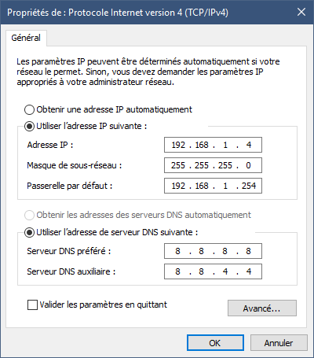
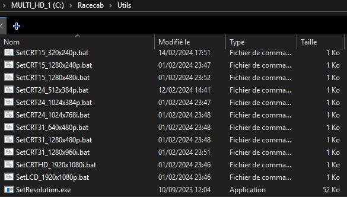

Distribution Sega Racer 2022-2024 - njz3

FOR ENGLISH TRANSLATION, PLEASE USE https://www.deepl.com/ or https://translate.google.com/

# A propos

Cette image disque est basée sur un Windows 10 entreprise dont la configuration
a été adaptée aux racecabs.
Elle propose un frontend **AttractMode Plus**, avec la plupart des jeux et
émulateurs pré-configurés pour être jouables immédiatement en mode retour de
force. Hyperspin est toujours présent sur le disque mais **n'est plus le
frontend lancé au démarrage** : tout ce qui concerne les listes de jeux se
passe désormais dans `C:\Racecab\AttractPlus`.
Les dernières versions des émulateurs sont utilisés, en particulier :
- MAME pour les jeux anciens, ou ceux des générations 90/2000 de Namco ou Taito par exemple.
- sm2-emu pour Sega Model 2, MAME proposant les mêmes jeux en seconde liste
- Supermodel pour Sega Model 3
- Flycast pour Naomi 1/2 et Atomiswave
- Demul pour les jeux Gaelco ou Hikaru
- Dolphin pour les jeux Triforce
- Teknoparrot pour les jeux sur plateforme PC

> **Note (17/10/2026) :** Nebula Model 2 (`Model2 v1.1a`) est toujours installé
> mais **ne figure plus dans aucune liste de jeux**. Pour Sega Model 2, l'image
> n'utilise plus que sm2-emu et MAME. Manx TT SuperBike, Motor Raid et Wave
> Runner, que lui seul lançait, sont passés sur sm2-emu, en solo comme en link.

Le retour de force est soit natif à la plateforme ou à l'émulateur (model2,
supermodel), soit généré par le FFB plugin de Boomslangnz. Il a été réglé dans
le BackForceFeeder afin de restituer au plus juste les effets originaux quand
c'est possible.
Le mapping des boutons et des axes par défaut est actuellement celui de ma 
borne Le Mans à savoir 1 volant, 2 pédales, 1 Start, 2 view buttons, 1 shifter
Up/Down.
Je laisse à chacun le soin de refaire le mapping selon sa borne via mon soft
BackforceFeeder en suivant le nommage déjà pré-établi pour les boutons de 
chaque jeu. Il y a des exemples de ControlSets disponibles dans le dossier 
```Documents\BackForceFeeder\ControlSets-XXX```

La distribution fonctionne en mode FullHD (1920x1080) sur l'ensemble des jeux. 
En se limitant aux jeux MAME, model 1/2/3 et Flycast (Naomi) la distribution
peut fonctionner en 24 kHz à l'aide du videoamp en 1024x768i ou 1024x384p, ou
en 15 kHz avec le videoamp en mode 1280x240p ou 1280x480i (image étirée).


# Configuration Hardware

> **IMPORTANT**
> Au premier démarrage, laisser le temps à Windows de démarrer puis installer
> vos drivers.

Si vous pouvez connecter votre PC à internet, faites Windows Update pour
récupérer vos drivers automatiquement.
Le SSD est prévu pour fonctionner sur un PC avec :
- un processeur intel 4th gen (ou plus récent), ou un AMD Ryzen.
- 4GB de RAM minimum
- une carte graphique type Nvidia 1030 ou plus récent (1050Ti recommandé)
- une souris ou un clavier USB branché en permanence (ceci afin de pouvoir
utiliser la fonction d'émulation de clavier DInput)
- soit un moniteur LCD FullHD pour profiter de l'ensemble des jeux, soit un 
moniteur CRT supportant le 1024x768 (31kHz ou 24kHz entrelacé) pour pratiquement
tous les jeux hors jeux Teknoparrot HD. 
Une edition spécifique 15kHz en 1280x240p ou 1280x480i en mode "stretch" est 
possible avec moins de jeux (uniquement MAME, model 1/2/3 et Naomi via Flycast).


# Configuration Windows

## Reseau

IP: 192.168.1.4 pour cabine 1 (ou 192.168.1.5 ou .6, .7, .. selon la cabine en multi)
Masque de sous-réseau: 255.255.255.0
Passerelle : 192.168.1.254 (modifable selon votre réseau LAN en 192.168.1.1)
DNS : 8.8.8.8 ou 8.8.4.4 (DNS de Google)
Broadcast address: 192.168.1.255

Mettre réseau privé et désactiver le Firewall.

> **Note:**
Pour le jeu en réseau sur model 2 emulator (Sega Rally, Daytona 1, etc.)
if faut impérativement activer le support des trames de longues taille (3kB)
soit via une option de votre carte réseau, soit activer l'option "Jumbo Frames"
dans votre carte Ethernet (MTU >3kB) et avoir un switch Ethernet 1GBit qui 
supporte les "Jumbo Frames".

.

## Softs pré-installés

Le chemin C:\Racecab\Utils est ajouté dans la variable d'environement PATH du système.
Sont pré-installés :
- Les redistribuables VC Runtime Visual C++ (x86 et x64) en version 2010 (vcr100), 2012 (vcr110), 2013 (vcr120), 2015-2022 (vcr140).
- Dans les composants Windows (ajout/suppresion de composants) : DirectX (ajout composants graphiques windows), DirectPlay (ajout legacy componants/DirectPlay), Lecteur Multimedia
- La font BebasNeue.ttf (héritage de RocketLauncher, qui n'est plus installé ; certains thèmes s'en servent encore)
- Les utilitaires comme VLC, TightVNC, WinMerge, Putty, Teamviewer, Firefox.
- vJoy 2.2.2.0 (un périphérique, 4 axes dans l'ordre X, Y, Z, Rx, 32 boutons, tous les effets actifs), BFF
- Si vous voulez passer en mode TESTSIGN ON (pour vjoy non signé sous Windows 11 par exemple), utiliser Universal Watermark Disabler
- dk2win3264_8.22.26.exe (driver dongle de licence) pour avoir le mode test dans le jeu Sega Racing Classic
- rapture3dgame_2.7.4_win.exe (driver son 3D) pour Sega Showdown
- wmv9VCMsetup.exe (decoder VM9 pour windows media player) pour Storm Racer G


## Mots de passe et prise en main à distance

Par défaut, Teamviewer et TightVNC (mode serveur) sont préinstallés.
Le mot de passe de session pour l'utilisateur Racecab (admin) est `racecab`
Le mot de passe pour Teamviewer est `Racecab22!`
Le mot de passe pour VNC est `racecab`

> **ATTENTION :** ces trois mots de passe sont les mêmes sur toutes les copies
> de l'image, et ils donnent un accès distant complet à la machine. Si la
> borne est reliée à un réseau qui n'est pas le vôtre, changez-les au premier
> démarrage, ou désactivez TeamViewer et TightVNC si vous ne vous en servez
> pas.


## Démarrage automatique d'un jeu

Par défaut, deux raccourcis sont installés dans le répertoire de démarrage
automatique
```C:\Users\Racecab\AppData\Roaming\Microsoft\Windows\Start Menu\Programs\Startup``` :
- `startAttractModePlus.bat` (qui lance `C:\Racecab\AttractPlus\attractplus.exe`
  après quelques secondes d'attente, le temps que Windows finisse de démarrer) ;
- `BackForceFeederGUI`.

Si vous souhaitez ne pas faire démarrer automatiquement le frontend, mais un
jeu en particulier, supprimez le raccourci `startAttractModePlus.bat` et créez
-en un autre vers l'émulateur ou le jeu que vous souhaitez lancer.

## FFB dans les émulateurs

En cas de changement ou de ré-installation de vjoy, re mettre vJoy en volant 
à retour de force via le plugin FFB dans :
```
C:\Racecab\Emulators\Demul_07a_[180428]_Gaelco
C:\Racecab\Emulators\Demul_07a_[180428]_Gaelco_SD
C:\Racecab\Emulators\Demul_07a_[180428]_Hikaru
C:\Racecab\Emulators\Flycast
C:\Racecab\Emulators\Flycast LINK
C:\Racecab\Emulators\Mame
C:\Racecab\Emulators\Mame LINK
C:\Racecab\Emulators\Model2 v1.1a
C:\Racecab\Emulators\Model2 v1.1a LINK
C:\Racecab\Emulators\Supermodel
C:\Racecab\Emulators\Supermodel LINK
```

Teknoparrot:
```
C:\Racecab\Games\Batman - Raw Thrills PC Based\ZeusSP
C:\Racecab\Games\Battle Gear 4 Tuned 2.8 - Taito Type X +
C:\Racecab\Games\Battle Gear 4 Tuned 2.8 Professional Edition - Taito Type X +
C:\Racecab\Games\Chase H.Q. 2 - Taito Type X 2
C:\Racecab\Games\Daytona Championship USA\Sega\Daytona
C:\Racecab\Games\Daytona Championship USA New Season Edition\Sega\Daytona
C:\Racecab\Games\Dirty Drivin - Raw Thrills PC Based
C:\Racecab\Games\Ford Racing Full Blown - SEGA Arcade PC Based\FordRacing
C:\Racecab\Games\GTI Club Super Mini Fiesta - Konami PC Based
C:\Racecab\Games\H2 Overdrive - Raw Thrills PC based
C:\Racecab\Games\Initial D 4 - SEGA Lindbergh
C:\Racecab\Games\Initial D 4 Export (Fr Traduction) - SEGA Lindbergh
C:\Racecab\Games\Initial D 5 Export - SEGA Lindbergh
C:\Racecab\Games\Initial D 6 AA - SEGA Ringedge
C:\Racecab\Games\Initial D 7 AAX - SEGA Ringedge
C:\Racecab\Games\Initial D 8 Infinity - SEGA Ringedge
C:\Racecab\Games\Initial D Arcade Stage Zero v.2.30 - SEGA NU
C:\Racecab\Games\Mario Kart Arcade GP DX (V1.10 - Mod FR 1h) - Namco ES3
C:\Racecab\Games\Outrun 2 SP SDX - SEGA Lindbergh\disk0\Jennifer
C:\Racecab\Games\R-Tuned Ultimate Street Racing - SEGA Lindbergh
```
Attention pour les jeux Lindbergh comme Outrun2, il faut en plus copier les dll `opengl32.dll`
et `SDL2.dll` dans `C:\Racecab\Emulators\Teknoparrot\TeknoParrot`

Lancer MAME, vérifier qu'un jeu se lance.
Lancer Teknoparrot, vérifier qu'un jeu se lance.


# Les deux scripts de configuration : résolution et cabine

Deux choses changent d'une borne à l'autre : le **moniteur** et l'**identité
de la machine** dans un link. Chacune a son script, et les deux aboutissent au
même moteur, `Utils\config\Build-Config.ps1`.

| | Changement de résolution | Configuration de cabine |
|---|---|---|
| C'est une propriété du | moniteur | PC de la borne |
| Script à lancer | `Utils\SetXXX.bat`, un par mode vidéo | `Build-Config.ps1 -Cabine _link_cabN` |
| Quand | à chaque changement d'écran | une fois, en général au clonage du disque |
| Ce qu'il écrit | de la **configuration**, uniquement | de la configuration **et** les NVRAM |
| Où il note ce qui est en place | `C:\Racecab\Configured_for<RES>.txt` | `Utils\set_cab_id.bat`, et `_cabine.txt` dans chaque dossier NVRAM |

Le choix **solo ou link** n'est ni l'un ni l'autre : c'est le joueur qui le
fait à chaque partie, en prenant la liste Single ou la liste Multi
d'AttractMode Plus.

## Le changement de résolution, pas à pas

On lance le script du mode vidéo voulu, par exemple
`Utils\SetCRT31_640x480p.bat`. Il fait, dans l'ordre :

1. `SET RES_EXT=_640x480` — le **suffixe de résolution**. C'est lui qu'on
   retrouve dans le nom de toutes les variantes de fichiers (`GFX_640x480.ini`,
   `TeknoParrot_640x480.txt`…).
2. `SetResolution.exe -w 640 -h 480 -noprompt` — change la résolution de
   Windows.
3. Ce qui ne dépend que du format d'écran : la NVRAM de Virtua Racing sous MAME
   en 4:3 (`vr_4_3`) ou en 16:9 (`vr_16_9`).
4. `CALL SetVideoCommon.bat`, commun à toutes les résolutions, qui :
   - lit `set_cab_id.bat` pour connaître la cabine en place ;
   - recopie par `XCOPY` les variantes des émulateurs restés en dehors du
     moteur : `mame<RES>.ini` des trois MAME (normal, LINK, Namco LINK),
     `Emulator<RES>.ini` et `scripts<RES>` de Model 2, `GFX<RES>.ini` de
     Dolphin et des deux Triforce ;
   - appelle `Build-Config.ps1 -Res <RES>` pour tout le reste : sm2-emu,
     Supermodel, Flycast, les listes de jeux d'AttractMode Plus et les profils
     TeknoParrot ;
   - Build-Config laisse enfin le témoin `C:\Racecab\Configured_for<RES>.txt`.

Ce que fait Build-Config avec `-Res` : il lit `Utils\config\targets.csv`, une
ligne par fichier à produire, et traite chaque ligne selon son type.

| Type | Ce qu'il fait | Exemples |
|---|---|---|
| `TEMPLATE` | remplit un `.template` : chaque `{{MOT_CLE}}` reçoit sa valeur | `sm2-emu.ini`, `Supermodel.ini`, `emu.cfg` de Flycast |
| `VARIANT` | recopie le fichier tout fait dont le nom porte `{{RES}}` ou `{{CAB}}` | `TeknoParrot{{RES}}.txt`, `GFX_<RES>.ini` de Dolphin |
| `FOLDER` | **rien du tout** sur un changement de résolution | les NVRAM |
| `XML` | écrit largeur et hauteur *dans* les profils TeknoParrot | les profils de `UserProfiles\` |
| `STALE` | efface, dans le dossier d'écriture (`WRITEDIR_ROOT`), les copies de réglages qui diffèrent de l'original régénéré : l'émulateur les refait au lancement suivant | `Saves\linuxloader_*\linuxloader.ini` |

Les valeurs viennent de trois tables de `Utils\config\valeurs\`, la plus
précise l'emportant : `resolutions.csv` (largeur, hauteur, plein écran,
échelle de rendu, format) < `cabinets.csv` < `games.csv` (réglage propre à un
jeu). Un `{{MOT_CLE}}` resté sans valeur **fait échouer** la génération : mieux
vaut une erreur qu'une configuration à trous.

**Changer de résolution ne touche jamais aux NVRAM.** Les réglages du menu de
service et les meilleurs temps survivent à tous les changements d'écran.

Pour voir ce qui serait fait sans rien écrire :

```
powershell -ExecutionPolicy Bypass -File C:\Racecab\Utils\config\Build-Config.ps1 -Res _640x480 -WhatIf
```

**Ajouter une résolution**, c'est : une ligne dans `resolutions.csv`, la
variante de chaque cible `VARIANT` qui porte `{{RES}}`, et un `SetXXX.bat`
copié d'un voisin. Sans variante, la cible échoue, sauf si elle est marquée
`OPTIONAL` dans `targets.csv`.

## La configuration de cabine, pas à pas

```
powershell -ExecutionPolicy Bypass -File C:\Racecab\Utils\config\Build-Config.ps1 -Cabine _link_cab2
```

1. **Il réécrit `Utils\set_cab_id.bat`** : `set CAB_ID=_link_cab2`. C'est la
   seule source de l'identité ; elle ne se déduit **jamais** de l'adresse IP,
   puisque l'image part chez d'autres, sur d'autres réseaux.
2. **Il régénère la configuration** avec la ligne `_link_cab2` de
   `cabinets.csv` : adresse locale, adresse de la borne suivante, ports,
   index de cabine, force du retour de force en link. C'est ce qui produit le
   `sm2-emu.ini` et le `Supermodel.ini` du dossier LINK, et l'`emu.cfg` de
   Flycast LINK. La résolution en place est gardée.
3. **Il repose les NVRAM**, et c'est le seul moment où il le fait. Pour chaque
   cible `FOLDER`, il compare le témoin `_cabine.txt` du dossier vivant à la
   nouvelle cabine. S'ils diffèrent, il recopie le dossier modèle
   (`NVRAM_link_cab2` pour Supermodel, `saves_link_cab2` pour sm2-emu) dans le
   dossier vivant, puis réécrit le témoin.

Pourquoi des dossiers modèles plutôt qu'un réglage : le mode link et le numéro
de cabine sont **dans la NVRAM du jeu**, protégés par une somme de contrôle.
Changer un seul octet fait retomber le jeu aux réglages d'usine. Le seul moyen
sûr est une NVRAM réglée par le jeu lui-même, au menu de service, et capturée.

### Ce qui suit la cabine sans passer par Build-Config

- **Les lanceurs MAME link** (`Mame LINK`, `Mame Namco LINK`) lisent
  l'identité **à chaque lancement** : `CALL set_cab_id.bat`, puis
  `CALL set_cab_network%CAB_ID%.bat`, qui donne `LOCALIP`, `NEXTIP`,
  `LOCALPORT` et `NEXTPORT`. Ils prennent ensuite
  `-nvram_directory nvram%CAB_ID%`, une NVRAM par cabine, choisie par son nom.
- **Flycast** attribue le numéro de cabine d'après l'ordre de connexion au
  serveur : rien à préparer par cabine.
- **linuxloader et windowsloader** : leurs lanceurs link
  (`RunLinuxLoaderLinkGame.cmd`, `RunWindowsLoaderLinkGame.cmd`) lisent
  l'identité et les adresses à chaque lancement, comme MAME, pour deux bornes
  seulement (voir *Passer de deux à quatre bornes*).

### Les identités disponibles

Une ligne par identité dans `Utils\config\valeurs\cabinets.csv` :

| CAB_ID | Adresse | Borne suivante | Index | MAME : port local → suivant |
|---|---|---|---|---|
| `_single` | — | — | 0 | — |
| `_link_cab1` | 192.168.1.4 | 192.168.1.5 | 0 | 15112 → 15113 |
| `_link_cab2` | 192.168.1.5 | 192.168.1.4 | 1 | 15113 → 15112 |
| `_link_cab3` | 192.168.1.6 | 192.168.1.7 | 2 | 15114 → 15115 |
| `_link_cab4` | 192.168.1.7 | 192.168.1.4 | 3 | 15115 → 15112 |

Les bornes forment un **anneau croissant** : chacune émet vers la suivante, la
dernière vers la première. À deux bornes, cab1 et cab2 se renvoient l'une à
l'autre.

### Passer de deux à quatre bornes

Les fichiers des cabines 3 et 4 sont prêts, NVRAM comprises, mais la
configuration **active** reste à deux. Ce qui existe pour `_link_cab3` et
`_link_cab4`, et ce qui le lit :

| Fichiers des cabines 3 et 4 | Lus par |
|---|---|
| `Utils\set_cab_network_link_cab3.bat`, `_cab4.bat` (adresses et ports du tableau ci-dessus) | les lanceurs `Mame LINK` et `Mame Namco LINK`, à chaque lancement |
| les lignes `_link_cab3` et `_link_cab4` de `Utils\config\valeurs\cabinets.csv` (adresses, index 2 et 3, client Flycast du serveur 192.168.1.4, `ISPUsername` racecab3 / racecab4) | `Build-Config.ps1` : `sm2-emu.ini`, `Supermodel.ini` et `emu.cfg` de Flycast LINK, **obligatoires** (sans elles, `-Cabine _link_cab3` échoue) |
| `Supermodel LINK\NVRAM_link_cab3\`, `NVRAM_link_cab4\` | `Build-Config.ps1` |
| `sm2-emu LINK\saves_link_cab3\`, `saves_link_cab4\` | `Build-Config.ps1` |
| `Mame LINK\` et `Mame Namco LINK\nvram_link_cab3\`, `nvram_link_cab4\` | les lanceurs link (`-nvram_directory nvram%CAB_ID%`) |
| `Model2 v1.1a LINK\NVDATA_link_cab3\`, `_cab4\` ; `Flycast LINK\data_link_cab3\`, `_cab4\` | rien : modèles à recopier à la main dans le dossier vivant |

Les lanceurs link de **linuxloader** et de **windowsloader** lisent aussi
`set_cab_network<CAB_ID>.bat`, mais ne savent faire que deux bornes : toute
cabine autre que `_link_cab1` y est traitée comme la cabine 2.

Pour fermer l'anneau sur quatre, seule la cabine 2 change de suivante :

1. dans `cabinets.csv`, ligne `_link_cab2` : `IP_SUIVANTE` passe de
   `192.168.1.4` à `192.168.1.6` ;
2. dans `Utils\set_cab_network_link_cab2.bat`, pour MAME : `NEXTIP=192.168.1.6`
   et `NEXTPORT=15114` ;
3. sur les cabines 1 et 2, remplacer dans `Emulators\sm2-emu LINK\` le
   contenu de `saves_link_cab1` et `saves_link_cab2` par celui de
   `saves_link_cab1_4bornes` et `saves_link_cab2_4bornes` : Super GT 24h et
   Over Rev y sont en `LINK MAX 4`. À deux bornes, ce réglage les bloque sur
   « CHECKING NETWORK NOW » ; c'est pourquoi l'image reste en `LINK MAX 2` ;
4. relancer `Build-Config.ps1 -ForcerNvram` sur les cabines 1 et 2. L'identité
   ne change pas : sans `-ForcerNvram`, le témoin `_cabine.txt` concorde et les
   NVRAM ne seraient pas reposées. Les meilleurs temps sont perdus.

> Un anneau à quatre est **rompu** dès qu'une des quatre bornes est éteinte.
> Indy 500, notamment, attend que toutes soient allumées.

### Préparer un disque à cloner

1. poser l'identité voulue : `-Cabine _link_cab1` ;
2. lancer les jeux et faire leurs réglages au menu de service ;
3. figer ces réglages dans le modèle : `-EnregistrerModele`.

Les autres options : `-PourCabine _link_cabN` prépare les fichiers d'une
**autre** machine sans réécrire `set_cab_id.bat` de celle-ci ; `-ForcerNvram`
repose les NVRAM même si la cabine n'a pas changé (les meilleurs temps sont
perdus) ; `-Etat` dit, sans rien écrire, la cabine et la résolution en place
et ce que les NVRAM posées disent vraiment de leur mode. Le détail est dans la
section *Identité de cabine* plus bas.

# Changement de configurations vidéo

L'image standard contient des configurations d'émulateurs pour fonctionner
en mode FullHD 1080 et il est nécessaire de les changer pour changer de mode
vidéo. Des scripts `SetXXX.bat` sont présents dans le répertoire `Utils\` pour
réaliser le changement automatiquement. Chacun appelle
`SetResolution.exe -w <largeur> -h <hauteur> -noprompt` pour changer la
résolution de Windows, puis met les configurations d'émulateurs en accord.

## Changer de résolution

```
C:\Racecab\Utils\config\Build-Config.ps1 -Res _1280x960
C:\Racecab\Utils\config\Build-Config.ps1 -Res _320x240 -WhatIf   (voir sans écrire)
```

Omettre `-Res` garde la résolution en place et régénère tout le reste. Les
scripts `Utils\SetXXX.bat` enchaînent le changement Windows et cet appel.

`Build-Config.ps1` lit `Utils\config\targets.csv` — quelle source produit quel
fichier — et les tables de `Utils\config\valeurs\` (`resolutions.csv`,
`cabinets.csv`, `teknoparrot.csv`). Dans le nom de la **source**, `{{RES}}` et
`{{CAB}}` disent de quels axes la cible dépend : c'est ce qui permet de
changer de moniteur sans rien toucher à ce qui dépend de la cabine.

Cinq types de cible :

| Type | Ce que c'est | Exemple |
|---|---|---|
| `TEMPLATE` | un `.template` à mots-clés `{{AINSI}}` → le fichier produit | `sm2-emu.ini`, `Supermodel.ini`, `emu.cfg` de Flycast |
| `VARIANT` | un fichier déjà écrit, choisi par son nom → recopié | `TeknoParrot{{RES}}.txt` |
| `FOLDER` | un dossier modèle → recopié dans le dossier vivant | les NVRAM, **et seulement au changement de cabine** |
| `XML` | la résolution écrite *dans* les profils TeknoParrot | les 100 profils de `UserProfiles\` |
| `STALE` | les copies de réglages du dossier d'écriture → effacées si elles diffèrent de l'original | `linuxloader.ini`, `emu.cfg`, `Supermodel.ini`, `sm2-emu.ini`, `mame.ini`, `windowsloader.ini` |

Les mots-clés sont en anglais depuis le 28/10/2026 ; colonnes de `targets.csv` :
`TARGET;SOURCE;CAB;TYPE;OPTIONAL;WRITEDIR;TREE`. Pour une cible `FOLDER`,
`WRITEDIR` nomme le sous-dossier du dossier d'écriture (`Saves\<émulateur><CAB_ID>`)
que l'émulateur a amorcé depuis ce dossier vivant : il est vidé quand des NVRAM
sont posées, et l'émulateur le refait au lancement suivant. `TREE = yes` recopie
un modèle rangé par jeu avec ses sous-dossiers (linuxloader).

Une cible marquée `OPTIONAL` prévient au lieu d'échouer
si sa source manque. Un mot-clé resté sans valeur fait échouer la génération
plutôt que de déposer une configuration à trous.

### Les listes de jeux suivent la résolution

Tous les jeux MAME, sm2-emu, Supermodel et Flycast tournent en basse
résolution, mais pas tous les TeknoParrot ni tous les jeux de moto. Les
variantes `romlists\TeknoParrot<RES>.txt` et `Bike3D<RES>.txt` ne retirent pas
les lignes, elles les **commentent** avec un `#`, donc le fichier garde sa
structure. En dessous de 1024x768 : 22 jeux TeknoParrot au lieu de 59, et 11
motos au lieu de 18.

### Super-résolution : plein écran sans bordure, étiré

Quatre modes sont des **super-résolutions** : 1024x384, 1280x240, 1280x480 et
1920x240. Le moniteur CRT y affiche une image 4:3 avec des pixels très larges :
le jeu doit donc être **étiré** à toute la largeur. Dans ces quatre modes, tous
les émulateurs passent en **fenêtre plein écran sans bordure** (pas de plein
écran exclusif, pas de changement de mode vidéo), image étirée. Dans les autres
modes, ils restent sans bordure, aux proportions du jeu. Le bureau doit donc
déjà être dans la bonne résolution au lancement : c'est le rôle des
`SetXXX.bat`.

| Émulateur | Réglage en super-résolution | Où |
|---|---|---|
| linuxloader | `DISPLAY_MODE = BORDERLESS_STRETCH` | `linuxloader.ini`, gabarit, colonne `MODE_FENETRE` ; Build-Config efface les copies périmées de `Saves\linuxloader_*` (cible `STALE`), que linuxloader lit à la place de l'original |
| windowsloader | `DISPLAY_MODE = BORDERLESS_STRETCH` | `windowsloader.ini`, gabarit, colonne `MODE_FENETRE` (pas de dossier d'écriture : il lit l'ini de son dossier) |
| sm2-emu | `display_stretch = true` (avec `borderless_fullscreen = true`) | `sm2-emu.ini`, gabarit, colonne `ETIRER` |
| Supermodel | `FullScreen`, `BorderlessFullScreen`, `Stretch` à `true` | `Supermodel.ini`, gabarit, colonne `ETIRER` |
| Flycast | `window:fullscreen=yes` (déjà sans bordure) et `rend.StretchToFill = yes` | `emu.cfg`, gabarit, colonne `FLYCAST_ETIRER` |
| MAME | `keepaspect 0` (déjà étiré par `unevenstretch`) | `mame.ini`, gabarits (`Mame\mame.ini.template` pour Mame et Mame LINK, `Mame Namco LINK\mame.ini.template`), colonnes `ASPECT` et `MAME_*` |

> **sm2-emu : `display_stretch`, pas `aspect_mode = stretch`.** `aspect_mode`
> ne garde que 4:3 ou 16:9 ; l'ancienne valeur `stretch` est encore lue, mais un
> `display_stretch = false` réenregistré par une version récente l'écrase.
> Et **`aspect_mode = 16:9`, que l'image pose en HD, n'est pas un format
> d'image** : c'est l'écran large expérimental, qui élargit la 3D. À garder
> seulement si l'on veut cet écran large.

> **Flycast : `rend.StretchToFill`, pas un pourcentage.** L'image a d'abord
> utilisé `rend.ScreenStretching` (400 en 1280x240, 200 en 1024x384), à
> recalculer pour chaque résolution. `StretchToFill` étire à la fenêtre quelle
> qu'elle soit ; `ScreenStretching` est alors ignoré et laissé à 100.

**Ajouter une super-résolution** : sa ligne dans `resolutions.csv` avec
`BORDERLESS_STRETCH` et `true` dans les deux dernières colonnes, un
`SetXXX.bat`, les colonnes `FLYCAST_*`, `SUPERMODEL_*` et `MAME_*` (celles
de 1280x240), et les variantes clonées de 1280x240 : les `GFX_<RES>.ini` de Dolphin et des Triforce, et les listes `TeknoParrot` et
`Bike3D`. Model 2 Emulator, abandonné, n'a pas de variante 1920x240.

### La résolution dans les profils TeknoParrot

Le type `XML` règle la résolution directement dans les profils, d'après la
table `valeurs\teknoparrot.csv`. Il faut une table parce que **les noms de
champs ont six graphies** selon le jeu (`ResolutionWidth`,
`Custom Resolution Width`, `Resolution Width`, `Screen Width`, `CustomWidth`,
`Width`), et parce que des champs comme `ShadowMapWidth` ou `SpecularWidth`
portent eux aussi des valeurs de résolution : les écraser casserait le rendu.
`CustomResolution` est mis à `1` dès qu'il existe. Une copie `.origine` est
gardée au premier passage.

.

Liste des résolutions:

- FullHD 1080p/i

Tous les jeux fonctionnent en Full HD.


- LCD 2560x1440p et 3840x2160p (moniteurs haute définition)
- CRT 1280x960p/i (moniteur PC ou Videoamp 31 kHz entrelacé sur VGA natif)
- CRT 1024x768p/i (moniteur PC ou Videoamp 24 kHz entrelacé sur VGA natif)

Tous les jeux sauf certains Teknoparrot qui ne supportent que la HD 16/9e.


- CRT 640x480p (Videoamp 31 kHz progressif)
- CRT 1280x480p (Videoamp 31 kHz progressif stretch)
- CRT 1024x384p (Videoamp 24 kHz progressif stretch)
- CRT 512x384p (Videoamp 24 kHz progressif en activant GPU scaling)
- CRT 1280x240p (Videoamp 15 kHz progressif stretch)
- CRT 1920x240p (Videoamp 15 kHz progressif stretch)
- CRT 1280x480i (Videoamp 15 kHz entrelacé stretch sur VGA natif)
- CRT 320x240p (Videoamp 15 kHz progressif en activant GPU scaling)

> **Note :** les fréquences ci-dessus sont les fréquences **horizontales**, en
> kHz. Chaque ligne correspond à un script du dossier `Utils` : s'il n'y a pas
> de script, la résolution n'est pas prévue par l'image.

Seuls les jeux : MAME, model 2, model 3 et Naomi (Flycast) fonctionnent.

## Super-résolution d'une fenêtre : SuperResScaler

`C:\Racecab\Utils\superres` contient **SuperResScaler** 0.2.0 (source :
github.com/njz3/superres_scaler, commit `dec217e`). Il agrandit à l'écran la
**fenêtre** d'un jeu ou d'un émulateur, à travers un shader, pour l'afficher sur
un CRT en super-résolution (1920x240, 2560x240…) alors que le jeu, lui, tourne
dans sa résolution d'origine.

- **Entrée** : une fenêtre Windows existante, en fenêtré ou sans bordure,
  capturée par Windows.Graphics.Capture. Un plein écran *exclusif* ne se
  capture pas.
- **Sortie** : une surcouche plein écran, toujours au premier plan et
  transparente aux clics : le jeu garde le clavier et la manette.
- Depuis un lanceur :
  `SuperResScaler.exe --process jeu.exe --resolution 1920x240@60 --aspect 4:3 --mode stretch`.
  Il attend la fenêtre (60 s par défaut), la met à l'échelle et se ferme avec
  elle. Codes de sortie : 0 bon, 2 fenêtre introuvable, 3 échec. `--resolution`
  change le mode de l'écran le temps de la session, puis le remet.
  `--list-modes` liste les modes du pilote, `--help` toutes les options.
- **Autonome** : runtime .NET intégré, rien à installer. Windows 10 2004 ou
  plus récent, carte Direct3D 11. Les modes super-résolution doivent exister
  dans le pilote NVIDIA (résolutions personnalisées ou CRU).
- **Deux façons de s'en servir.** Par la ligne de commande ci-dessus, depuis un
  lanceur ; ou en tâche de fond, `SuperResScaler.exe --tray` lancé au démarrage
  de Windows : il surveille les processus et démarre la mise à l'échelle dès
  qu'un jeu d'un **profil** s'ouvre, puis remet la résolution d'origine à sa
  fermeture. Un profil associe des réglages (shader, format, rognage,
  résolution) à un filtre de fenêtres écrit comme ceux de BackForceFeeder
  (nom de processus avec `*`, `?` et `|`, titre facultatif). **Jamais les deux
  à la fois pour un même jeu** : ils viseraient la même fenêtre.
- Lancé sans paramètre, il ouvre son interface : Accueil, Profils, Paramètres.
- **Écritures**, uniquement dans son dossier : `SuperResScaler.log`, et
  `settings.json`, qui contient désormais **les profils** et est réécrit à
  chaque modification dans l'interface. Sous UWF : soit exclure
  `settings.json` pour pouvoir créer des profils sur la borne, soit écrire les
  profils dans le `settings.json` de l'image **avant** d'activer le filtre
  (exemple dans son `README.md`, section Réglages). Le fichier livré n'a aucun
  profil.

> Pas encore éprouvé sur la borne : la bascule réelle de résolution et le
> rendu sur la carte NVIDIA (mis au point sur un Intel UHD).

## Utiliser des basses résolutions en utilisant le GPU Scaling sur le VideoAmp

Exemple : sortir du 512x384p en utilisant le VideoAmp sur une carte NVidia 
1050Ti.
1. Configurer le VideoAmp avec 2 résolutions : la (P)referred en 1024x384p,
la suivante en supplémentaire 512x384p avec exactement le même timing vertical
(même valeur en vertical dans la modeline).
2. Brancher le VideoAmp qui va etre détecter comme écran 1024x384p
3. Aller dans le NVidia "Control Panel", ou Intel ou AMD, et dans la page 
"Régler la taille et la position", activer le plein écran ou le mode Stretch.
4. Dans les propriétés d'affichage de Windows, sélectionner la résolution
512x384p, et vous aurez automatiquement un plein écran avec scaling par GPU.


# Les lanceurs

## Un lanceur générique par émulateur, et non un .bat par jeu

L'image est passée d'un fichier `.bat` par jeu à **un lanceur générique par
émulateur**, qui reçoit le nom de la ROM en argument :

| Dossier | Solo | Link |
|---|---|---|
| `sm2-emu` / `sm2-emu LINK` | `RunSm2Game.cmd` | `RunSm2LinkGame.cmd` |
| `Supermodel` / `Supermodel LINK` | `RunSupermodelGame.cmd` | `RunSupermodelLinkGame.cmd` |
| `Flycast` / `Flycast LINK` | `RunFlycastGame.cmd` | `RunFlycastLinkGame.cmd` |
| `Mame` / `Mame LINK` | `RunMAMEGame.cmd` | `RunMAMELinkGame.cmd` |
| `Mame Namco LINK` | — | `RunMAMENamcoLinkGame.cmd` |
| `Model2 v1.1a` / `... LINK` | `RunModel2Game.cmd` | `RunModel2LinkGame.cmd` |
| `Teknoparrot<version>` | `RunTeknoParrotGame.cmd` | `RunTeknoParrotLinkGame.cmd` |
| `Dolphin`, `Triforce`, `Demul_*` | `RunDolphinGame.cmd`, `RunTriforceGame.cmd`, `RunDemulGame.cmd` | — |

AttractPlus les appelle toujours de la même façon, définie dans
`AttractPlus\emulators\<Ému>.cfg` :

```
executable   cmd.exe
args         /c start "[name]" /WAIT Run<Ému>LinkGame.cmd [name]
workdir      C:/Racecab/Emulators/<dossier>
```

Les anciens `.bat` par jeu restent présents pour les cas particuliers et pour
un lancement à la main, mais ce ne sont plus eux qu'AttractPlus utilise.

## Le titre de la fenêtre : toujours entre crochets

Tout lanceur pose `TITLE [%ROM%]` (ou `TITLE [%~n0]` pour un `.bat` de jeu).

> **Les crochets ne sont pas décoratifs.** C'est à eux que le BackForceFeeder
> reconnaît le jeu pour choisir son profil, et ils évitent qu'un `[id5]` soit
> pris pour le `[id58]` d'un autre jeu. Un lanceur qui écrit `TITLE %ROM%`
> sans crochets empêche BFF d'identifier le jeu — c'est un défaut qui a été
> trouvé sur une cabine entière en octobre 2026.

Corollaire : **ne jamais utiliser `START`** pour lancer l'émulateur depuis le
lanceur. La console doit vivre aussi longtemps que le jeu, pour qu'AttractPlus
continue de l'attendre et que BFF garde le titre qu'il lit.

## Comment le lanceur sait s'il est en solo ou en link

Deux mécanismes, selon l'émulateur.

**Par le dossier** — sm2-emu, Supermodel, Flycast, MAME, Model 2 : le dossier
`<Ému>` porte la configuration et les NVRAM solo, le dossier `<Ému> LINK` les
siennes pour le link. Le joueur choisit en prenant la liste Single ou la liste
Multi dans AttractPlus, ce qui appelle l'un ou l'autre lanceur. **On peut donc
jouer en solo comme en link depuis n'importe quelle cabine, à tout moment.**

**Par le suffixe `_link`** — TeknoParrot : solo et link partagent le même
dossier et le même exécutable. AttractPlus donne au lanceur l'`AltRomname`
du jeu, et c'est le suffixe qui tranche :

```bat
set ROM=%~n1
if /I "%ROM:~-5%"=="_link" (
    CALL "%~dp0RunTeknoParrotLinkGame.cmd" %ROM%
    EXIT
)
set CAB_ID=_single
```

En link, `CALL set_cab_id.bat` donne `CAB_ID` = `_link_cab1` ou `_link_cab2`.

> **Piège.** Comme le lanceur link reçoit un ROM terminé par `_link`,
> `set GAME=%ROM%.xml` y vaut `<jeu>_link.xml` — un profil qui n'existe pas.
> **Chaque jeu link doit donc avoir une étiquette `:prep_<rom>_link` qui nomme
> le vrai profil**, par exemple `set GAME=or2spdlx.xml`. Sans elle,
> TeknoParrotUi s'ouvre sur sa liste de jeux et ne lance rien, *sans aucun
> message d'erreur*. Deux jeux ont été trouvés dans cet état en octobre 2026
> (Outrun 2 SP DX et Mario Kart DX).

## Les NVRAM que l'émulateur écrit toujours au même endroit

TeknoParrot écrit l'eprom et la sram de chaque jeu dans
`%APPDATA%\TeknoParrot`, toujours sous le même nom (`SBxx_e2prom.bin`,
`SBxx_sram.bin`) : **il ne sait pas distinguer le solo du link.**

La solution est un **lien dur recréé à chaque lancement**, par la routine
`:lier_appdata` présente dans les deux lanceurs TeknoParrot. Elle traite tout
`*_e2prom.bin` et `*_sram.bin` sans table de correspondance jeu ↔ code `SBxx`,
donc un jeu ajouté plus tard est couvert sans rien changer :

```bat
:lier_appdata
set "TPDATA=%APPDATA%\TeknoParrot"
if not exist "%TPDATA%" goto :eof
for /f "delims=" %%f in ('dir /b "%TPDATA%\*_e2prom.bin" "%TPDATA%\*_sram.bin" 2^>nul') do (
    call :lier_un "%TPDATA%\%%f" "%TPDATA%\%%~nf%CAB_ID%%%~xf"
)
goto :eof

:lier_un
if not exist %2 copy /Y %1 %2 >nul
del /F /Q %1 >nul 2>&1
mklink /H %1 %2 >nul 2>&1
if not exist %1 copy /Y %2 %1 >nul
goto :eof
```

Le jeu écrit alors directement dans la bonne variante : rien à recopier en
sortie, donc rien à perdre si la borne est coupée brutalement. La variante est
amorcée depuis le fichier vivant si elle n'existe pas, et un échec de `mklink`
laisse une copie — jamais de fichier perdu.

> Un lien dur ne survit pas à une copie au niveau fichier (robocopy, xcopy) :
> après clonage il redevient un fichier indépendant. Sans importance ici,
> **parce que le lien est refait à chaque lancement**.


# Identité de cabine : solo, link cabine 1, link cabine 2

## Le principe : deux axes qui ne se mélangent pas

- La **résolution** est une propriété du *moniteur*. Elle ne produit que de la
  configuration et se change n'importe quand.
- L'**identité de cabine** est une propriété de la *machine*. Elle est la
  seule à toucher à de l'*état* — les NVRAM, qui gardent les réglages du menu
  de service et les meilleurs temps. On en change une fois, en général au
  moment de cloner le disque.
- **Solo ou link n'est ni l'un ni l'autre** : c'est le choix du joueur à
  chaque lancement, en prenant la liste Single ou la liste Multi.

Changer de résolution ne doit donc **jamais** réinitialiser une NVRAM.

## En pratique

L'identité de cette machine est dans `C:\Racecab\Utils\set_cab_id.bat` :

```bat
set CAB_ID=_link_cab1
```

Pour en changer :

```
C:\Racecab\Utils\config\Build-Config.ps1 -Cabine _link_cab2
```

Le script réécrit `set_cab_id.bat`, régénère les configurations d'émulateurs
et **repose les NVRAM de la nouvelle cabine**. Les identités disponibles sont
les lignes de `Utils\config\valeurs\cabinets.csv` :

```
CAB;LINK_ACTIF;IP_LOCALE;MASQUE;IP_SUIVANTE;PORT_LOCAL;PORT_SUIVANT;INDEX_CABINET;FORCE_FFB;FLYCAST_SERVEUR_LOCAL;FLYCAST_SERVEUR;FLYCAST_NOM
_single;false;;;;1970;1970;0;100;false;;racecab1
_link_cab1;true;192.168.1.4;255.255.255.0;192.168.1.5;1970;1970;0;30;true;;racecab1
_link_cab2;true;192.168.1.5;255.255.255.0;192.168.1.4;1970;1970;1;30;false;192.168.1.4;racecab2
_link_cab3;true;192.168.1.6;255.255.255.0;192.168.1.7;1970;1970;2;30;false;192.168.1.4;racecab3
_link_cab4;true;192.168.1.7;255.255.255.0;192.168.1.4;1970;1970;3;30;false;192.168.1.4;racecab4
```

Les trois colonnes `FLYCAST_*` règlent le link de Flycast (voir *Jeux Naomi —
Flycast*) : cab1 est le serveur, les autres s'y connectent.

En link les cabines forment un anneau croissant ; à deux bornes, le
suivant de l'une est l'autre. Voir *Passer de deux à quatre bornes* plus
haut pour fermer l'anneau sur quatre.

> **L'identité ne se déduit jamais de l'adresse IP.** L'image part chez
> d'autres personnes, sur d'autres réseaux. Seul `set_cab_id.bat` fait foi.

## Les dossiers modèles de NVRAM

Une cible de type `FOLDER` dans `targets.csv` associe un dossier vivant à un
dossier modèle par cabine, par exemple :

```
Emulators\Supermodel\NVRAM;Emulators\Supermodel\NVRAM_single;_single;DOSSIER;
Emulators\Supermodel LINK\NVRAM;Emulators\Supermodel LINK\NVRAM{{CAB}};__CAB__;DOSSIER;
```

Le dossier vivant porte un témoin `_cabine.txt` qui dit pour quelle cabine il
est posé. **Tant que ce témoin correspond, le dossier n'est pas touché** : un
changement de résolution passe donc sans rien écraser, et les meilleurs temps
sont préservés.

Pour figer les réglages courants dans le modèle — typiquement avant de cloner,
ou après une mise à jour d'émulateur qui change le format des NVRAM :

```
C:\Racecab\Utils\config\Build-Config.ps1 -EnregistrerModele
```

Il refuse d'écrire si le témoin du dossier vivant désigne une autre cabine,
pour ne pas enregistrer les réglages d'une cabine sous le nom d'une autre.

Pour repartir des réglages du modèle alors que la cabine n'a pas changé —
**les meilleurs temps sont perdus** :

```
C:\Racecab\Utils\config\Build-Config.ps1 -ForcerNvram
```

Et pour voir sans rien écrire ce que les NVRAM posées disent vraiment du mode
et de l'identité :

```
C:\Racecab\Utils\config\Build-Config.ps1 -Etat
```

## Régler l'identité dans le jeu lui-même

Pour la plupart des jeux link, **l'émulateur ne décide pas** qui est maître et
qui est esclave : c'est un réglage du jeu, dans sa NVRAM, à faire une fois par
cabine au menu de service. Voir les sections par émulateur plus bas.


# Pour ajouter un jeu 1P


## Stockage du jeu

Mettre le jeu dans un dossier sous `C:\Racecab\Games` (si natif windows ou 
teknoparrot) ou directement dans `C:\Racecab\Emulators\XXX\roms` pour une
rom ou jeu émulé par XXX.


## Batch de lancement

> **À lire d'abord : la section « Les lanceurs ».** Les émulateurs de l'image
> ont désormais un lanceur générique par émulateur, qui reçoit le nom de la
> ROM en argument. Un `.bat` par jeu ne reste nécessaire que pour un cas
> vraiment particulier, ou pour un jeu natif Windows lancé directement.

Comme pratiquement chaque jeu a une configuration propre pour le FFB ou les
boutons, il est conseillé de faire un fichier .bat pour chaque jeu, qui sera
placé dans le dossier du jeu ou de l'émulateur qui va le lancer.

Nommer votre fichier .bat de manière unique et identifiable facilement. Si 
possible, prendre un nom sans espace et qui correspont à un nom de rom unique.
Par exemple : "daytonas.bat" dans le dossier de `C:\Racecab\Emulators\Model2 v1.1a`
(rom "daytonas" pour le jeu Daytona Saturn Ads).

Au besoin, placez les arguments dont vous avez besoin dans le .bat.
Des utilitaires dans `C:\Racecab\Utils` vous permettent de faire des actions de
bases, comme lancer un emulateur, appuyer sur une touche, tuer un process,
changer de résolution, etc.
En particulier, je recommande de mettre la fenetre en mode "minimized" dès le
lancement et de donner un titre de fenetre (via la commande `TITLE`) qui soit
unique pour le jeu, afin que le BackForceFeeder puisse identifier quel jeu est
lancé.

Vérifier à la main que le jeu se lance via votre .bat.


## Configuration AttractMode Plus

Tous les émulateurs partagent le même puits de visuels, nommé `Mame` pour des
raisons historiques. Les fichiers portent **exactement le nom de la ROM** tel
qu'il figurera en première colonne de la liste (exemple : `daytonas`).

- L'image de titre (la roue) dans
`C:\Racecab\AttractPlus\Media\Mame\wheel` (exemple : `daytonas.png`)
- La capture d'écran dans
`C:\Racecab\AttractPlus\Media\Mame\snap`
- La vidéo au format mp4 dans
`C:\Racecab\AttractPlus\Media\Mame\video`
- Le flyer et le marquee, facultatifs, dans les dossiers `flyer` et `marquee`
du même répertoire

Les visuels des menus d'affichage, eux, sont dans
`C:\Racecab\AttractPlus\menu-art`.

Ajouter ensuite une ligne dans la liste du jeu, par exemple
`C:\Racecab\AttractPlus\romlists\Supermodel.txt`. Le format est un CSV à
**21 colonnes séparées par des points-virgules**, dont l'en-tête est rappelé
en première ligne du fichier :

```
#Name;Title;Emulator;CloneOf;Year;Manufacturer;Category;Players;Rotation;Control;Status;DisplayCount;DisplayType;AltRomname;AltTitle;Extra;Buttons;Series;Language;Region;Rating
daytona2;Daytona USA 2 Battle On The Edge;Supermodel;;;;Nascar;;;;;;;;;;;;;;
```

Seules trois colonnes sont indispensables : `Name` (le nom de la ROM, qui sert
aussi à nommer les visuels), `Title` (ce qui s'affiche) et `Emulator` (le nom
d'un fichier de `C:\Racecab\AttractPlus\emulators`). La colonne 14,
`AltRomname`, sert aux jeux lancés par un script dédié.

> **Note :** chaque liste existe en `.txt` et en `.csv`, avec un contenu
> identique. Modifiez les deux, ou copiez l'un sur l'autre.

Le choix de l'émulateur se fait dans la troisième colonne : c'est le nom
d'un fichier de `C:\Racecab\AttractPlus\emulators`, qui décrit à son tour
quoi lancer. Par exemple `Supermodel.cfg` :

```
executable              cmd.exe
args                    /c start "[name]" /WAIT RunSupermodelGame.cmd [name]
workdir                 C:/Racecab/Emulators/Supermodel
rompath                 C:/Racecab/Emulators/SupermodelRoms
romext                  .zip
```

`[name]` est remplacé par la première colonne de la liste, `[AltRomname]` par
la quatorzième. Pour un jeu qui a besoin d'un traitement particulier, utilisez
l'émulateur `RunAltRomname` et mettez le chemin de votre script en colonne 14.

> **ATTENTION**
pour retirer temporairement un jeu, mettez un `#` en début de sa ligne dans la
romlist. AttractMode Plus ignore les lignes commentées.

Une fois la ligne ajoutée, lancez AttractMode Plus et vérifiez que le jeu
apparaît dans la bonne liste et se lance. Si la liste ne change pas, c'est
qu'AttractMode Plus garde un cache : supprimez le contenu de
`C:\Racecab\AttractPlus\cache`.

Les affichages eux-mêmes — quel menu montre quelle liste — sont décrits dans
`C:\Racecab\AttractPlus\config\displays.cfg`, un bloc `display` par entrée
de menu. **Un affichage qui pointe vers une romlist absente ouvre une liste
vide** : si vous supprimez une liste, supprimez aussi son bloc.

## Configuration BackForceFeeder

Ajouter un nouveau control set en duplicant un existant.

Pour automatiquement détecter le jeu dans le BFF, préciser soit le nom de 
l'exécutable et le titre de la fenetre principale, soit dans le fichier .bat 
ajouter un TITLE avec un titre unique ou le nom du fichier .bat. Dans ce cas,
dans le BFF, indiquer `conhost|cmd` dans l'exe, et en nom de fenetre ce que 
vous avez mis en TITLE de votre .bat (en général nom du fichier .bat).

Lancer le jeu via le .bat et verifier que le BFF bascule vers le control set
(vous devez avoir coché l'autodetection dans App&Hardware pour que cela marche).


# Pour ajouter un jeu MULTI

Procéder exactement comme en 1P, mais dans les listes et avec les émulateurs
du mode link, dont le nom se termine par `Multi`.

Penser à faire un lanceur différent si besoin pour distinguer le 1P du MULTI :
par convention, `Run<Ému>Game.cmd` en solo et `Run<Ému>LinkGame.cmd` en link,
dans le dossier `<Ému> LINK` de l'émulateur.

En résumé :

1) Les visuels sont les mêmes qu'en 1P, dans
`C:\Racecab\AttractPlus\Media\Mame` : rien à ajouter si le jeu existe déjà
en solo.

2) Ajouter la ligne du jeu dans la liste MULTI correspondante, par exemple
`C:\Racecab\AttractPlus\romlists\SupermodelMulti.txt` (et son `.csv`), en
mettant dans la colonne `Emulator` le nom de l'émulateur link, par exemple
`SupermodelMulti`.

3) Vérifier que l'affichage correspondant existe dans
`C:\Racecab\AttractPlus\config\displays.cfg`.

4) Si besoin, configurer le BFF pour détecter votre lanceur ou votre jeu et
configurer les contrôles, les lampes ou le retour de force.

> **Note :** l'identité de cabine (cabine 1, cabine 2, …) ne se choisit pas
> dans la liste mais dans `C:\Racecab\Utils\set_cab_id.bat`, et le joueur
> choisit solo ou link en prenant la liste Single ou la liste Multi.


# Modifier/ré-ordonner la liste de jeux

L'ordre d'affichage est celui des lignes dans la romlist : pour réordonner,
déplacez les lignes dans le fichier ; pour cacher un jeu, mettez un `#` en
début de ligne.

Les listes sont dans `C:\Racecab\AttractPlus\romlists`, une par affichage —
`Supermodel.txt`, `Flycast.txt`, `MAME3D.txt`, `TeknoParrot.txt`, et leur
équivalent `...Multi.txt` pour le mode link. Chaque liste existe aussi en
`.csv`, au contenu identique : **modifiez les deux**.

Faites une sauvegarde avant d'éditer. Les listes `Bike3D_<résolution>.txt` et
`TeknoParrot_<résolution>.txt` sont des variantes par résolution, utilisées
quand le moniteur ne permet pas tous les jeux : si vous ajoutez un jeu, pensez
à le faire dans la variante correspondant à vos résolutions.


# Configuration du BackForceFeeder

Le logiciel BackForceFeeder est pré-installé et possède une configuration par
défaut pour la plupart des jeux en mode shifter Up/Down et 2x View Buttons.

Le logiciel nécessite un fichier `licence.dat` pour être activé, qui est fourni
sur demande par email à `bff.register@gmail.com` en indiquant votre ID de
machine et en joignant un don paypal à la même adresse email (un minimum de 20€
par machine est demandé).

Le fichier de licence est à placer dans le répertoire :
`C:\Users\Racecab\Documents\BackForceFeeder`

## Fichiers de configuration

Les configurations sont stockées dans le répertoire :
`C:\Users\Racecab\Documents\BackForceFeeder`

Le sous-dossier ControlSets contient en particulier les configurations pour
chaque jeu. Vous ne pouvez pas éditer à la main ces fichiers si le logiciel
fonctionne, il faut d'abord le fermer pour pouvoir modifier les fichiers.

## Configuration de vos boutons/axes

Pour configurer les contrôles pour votre propre panel/cablage, le mieux est 
de ne changer que le mapping des boutons par type d'émulateur (MAME, Model 2,
Supermodel, TP), puis d'utiliser la page "Explorer" de ControlSet pour 
copier-coller uniquement le mapping des entrées brutes, et/ou le calibrage 
des axes vers plusieurs ControlSets simultanément.

Des ensembles de jeux de paramètres ont été créés pour différents panels.
Le dossier `C:\Users\Racecab\Documents\BackForceFeeder\` contient plusieurs
sous dossiers dont le nom commence par `ControlSets-XXX`.
Après avoir éteint le BackForceFeeder, vous pouvez effacer le dossier ControlSets-XXX`
et le remplacer par un autre dossier qui correspond à votre panel.
Vous pouvez ensuite relancer le BackForceFeeder et faire le calibrage des axes
sur l'ensemble de paramètres `Default` et le dupliquer sur tous les autres ensemble
de paramètres.


# Notes - FAQ

## Correspondance des boutons et des axes

Tous les émulateurs de l'image partagent la même convention, relevée dans
leurs propres configurations (les `cfg` par jeu de MAME, `Supermodel.ini`,
`sm2-emu.ini`, les `mappings` de Flycast) :

| Entrée vJoy | Rôle |
|:--|:--|
| bouton 1 | **pièce** (coin) |
| bouton 2 | **test** |
| bouton 3 | **service** |
| bouton 4 | **départ** (start) |
| boutons 5 à 8 | vitesses, vues, selon le jeu |
| axe X | volant, 0,5 au centre |
| axe Y | accélérateur, 0,5 au repos, 0 à fond |
| axe Z | frein, 0,5 au repos, 0 à fond |

> **ATTENTION :** les boutons 2 et 3 ouvrent le menu de réglage du jeu. Un
> script de test automatique ne doit jamais les presser.

## Un jeu qui plante bloque tous les suivants

Quand un jeu plante, Windows ouvre une boîte d'erreur qui appartient au
processus système `csrss`. Tant qu'elle n'est pas acquittée :

- le processus du jeu **reste vivant et bloqué** dessus, et peut garder la
  main sur l'affichage — y compris en laissant le bureau dans la résolution
  du jeu ;
- **les erreurs suivantes font la queue derrière** : les jeux lancés ensuite
  échouent sans rien afficher d'exploitable, souvent avec un
  `D3DERR_DEVICELOST` (`0x88760868`).

Sur une borne laissée seule, un seul plantage non acquitté suffit donc à faire
tomber tout ce qui suit, sans message visible. **KO Drive le fait de façon
reproductible** à la fin de chaque partie.

Le remède, s'il y a plusieurs boîtes, est de les acquitter une par une : la
touche **Entrée** valide les boîtes de DLL (`FFBBlaster.dll` et consorts), la
touche **Échap** ferme les « Erreur d'application ». Puis vérifier qu'il ne
reste pas de processus de jeu, et remettre la résolution avec le script
`Utils\SetLCD_1920x1080p.bat`.

## Jeux Model 2 en mode Link

Pour avoir un bon fonctionnement en mode Link (MULTI) il est obligatoire
d'avoir un switch 1Gbs et d'activer le mode "Jumbo Frame", voir au début
de ce document.
La touche pour quitter l'émulateur est Alt+F4.

## Jeux Model 2 — sm2-emu

### `link_cabinet_index` ne sert à rien

Le fichier `sm2-emu.ini` contient un champ `link_cabinet_index`. **Il n'a
aucun effet sur le link.** Vérifié dans le code (`src/main.cpp`,
`configure_cabinet_link`) : il n'est lu qu'à deux endroits, le champ
« Cabinet number » de l'interface graphique et une ligne de journal INFO. Il
n'atteint ni la COMM board ni la ROM. Le mettre à 2 pour la cabine 2 ne change
que cette ligne de journal — l'essai a été fait sur la borne, l'écran du jeu
affichait toujours `CAR NUMBER 1`.

> La convention retenue dans `cabinets.csv` est donc celle que le code
> documente : **0-based**, soit `0` en solo, `0` pour la cabine 1 et `1` pour
> la cabine 2. Ce n'est qu'un marqueur de journal.

### D'où vient réellement MASTER / SLAVE

Du **réglage du jeu, dans sa NVRAM**, pas de l'émulateur. L'ID est ensuite
négocié sur l'anneau : le maître est l'ID 1, chaque esclave incrémente la
trame d'assignation qui passe.

Conséquence directe : **deux NVRAM identiques donnent deux maîtres.** Chacun
prend alors la trame de l'autre pour la sienne revenue, conclut « id 1 sur 1 »,
et le jeu reste indéfiniment sur `NETWORK CHECKING`.

### Régler la cabine 2 en esclave (menu de service)

À faire **une fois par cabine et par jeu**, sur la cabine 2 :

1. Lancer le jeu depuis le dossier `sm2-emu LINK`.
2. Bouton **TEST** (bouton 2 du panneau) → `TEST MODE`.
3. Descendre sur `GAME SYSTEM`, valider avec **START**.
4. Sur la ligne `LINK ID`, changer la valeur jusqu'à `SLAVE`
   (le cycle est MASTER → SINGLE → SLAVE).
5. Ligne `CAR NUMBER` : mettre `2`.
6. `EXIT` de `GAME SYSTEM`, puis `EXIT` du `TEST MODE` — **c'est à ce moment
   que la backup RAM est écrite**.
7. Quitter l'émulateur proprement (Échap). Un processus tué de force perd le
   réglage.

Les touches du menu sont rappelées en bas de l'écran : `GREEN` curseur haut,
`RED` curseur bas, `YELLOW` valeur suivante, `BLUE` valeur précédente,
`START` valider.

### La NVRAM porte le nom du SET CHARGÉ, pas celui du raccourci

`saves\<set>.nv` et `saves\<set>.eeprom`. La liste Multi lance `daytonas`
(Daytona USA Saturn Ads), donc le fichier est `daytonas.nv` — et **pas**
`daytona.nv`, qui appartient à un autre set. Se tromper de fichier fait croire
à une configuration en place alors que le jeu démarre aux valeurs d'usine.
Même piège que pour Supermodel.

### sm2-emu réécrit son `.ini` en quittant

L'émulateur persiste ses réglages dans `sm2-emu.ini` à la fermeture. Un
fichier produit par `Build-Config.ps1` peut donc être réécrit par l'émulateur
avec ses propres valeurs. **Régénérer la configuration quand l'émulateur est
fermé**, et vérifier après coup si le réglage compte.

### Le dossier de ROMs : `rom_dir`, et rien d'autre

**C'est `rom_dir` de `sm2-emu.ini` qui décide**, et il vaut `..\MameRoms`.
Le `rompath` déclaré dans `AttractPlus\emulators\Sm2.cfg` ne sert qu'au
balayage des listes de jeux par AttractPlus : **il n'a aucun effet au
lancement**, puisque le lanceur passe seulement `--game <rom>` et laisse
l'émulateur résoudre le chemin.

> Le dossier `Emulators\Model2Roms` appartient à l'ancien Model 2 Emulator
> v1.1a. **sm2-emu n'y regarde jamais.** Une archive qui n'est que là est
> invisible pour lui — c'est ce qui a fait échouer Manx TT, Motor Raid et
> Wave Runner pendant des mois, et ça n'avait rien d'un défaut d'émulation.

Deux conséquences utiles :

- un jeu peut charger **sans que son archive existe à son nom**, si un set
  mergé la contient : `daytonas` n'a pas de `daytonas.zip` dans `MameRoms`,
  il est chargé depuis `daytona.zip`, un set mergé de 68 fichiers. C'est le
  même piège que pour les NVRAM — regarder le set, pas le raccourci ;
- **les ROMs sont reconnues par leur CRC32, pas par leur nom.** Un préfixe
  `mpr` au lieu de `epr`, un suffixe `.28`/`.29` croisé ou une lettre de
  révision en moins ne gênent pas. Inutile donc de conclure d'une liste de
  noms qu'un romset est incomplet : seul le log le dit.

### Jeux qui ne démarrent pas

`manxtt` et `manxttc` (Manx TT SuperBike) : il manque réellement
`epr-18643*.7` (région `cpu4`, CRC32 `0x7166fca7`) dans l'archive. Le log
est sans ambiguïté :

```
[ERROR] missing required ROM: 'epr-18643.7' (CRC32 0x7166fca7), region 'cpu4'
[ERROR] 'manxttc' cannot be loaded: 1 required ROM file(s) missing
```

Il faut un romset MAME plus récent qui contienne ce dump. Rien à corriger
dans l'émulateur ni dans la configuration.

> **Comment diagnostiquer un jeu qui ne démarre pas** : lancer
> `sm2-emu.exe --game <rom> --log-level debug` depuis le dossier de
> l'émulateur et lire la sortie. sm2-emu **n'ouvre jamais de boîte de
> dialogue** : il écrit des lignes `[ERROR] …` et quitte avec le code 1.
> Une boîte « Fatal Error » visible à l'écran vient donc d'autre chose —
> méfiance en particulier avec les boîtes d'erreur Windows orphelines, qui
> appartiennent à `csrss`, survivent au processus qui les a provoquées et
> restent affichées par-dessus les jeux suivants.

## Jeux Model 3 — Supermodel

Supermodel permet d'utiliser un shifter Up/Down pour les jeux à 4 vitesses,
ainsi il n'est pas nécessaire d'activer une émulation de séquence pour émuler
un shifter H4 depuis un Up/Down. Les paramètres sont "InputGearShiftUp" et
"InputGearShiftDown". Mais il reste tout à fait possible d'utiliser une
séquence ou directement un shifter H4 via le decodeur du BFF.

### Configuration par gabarits

Comme sm2-emu et Flycast, Supermodel n'a qu'un gabarit,
`Supermodel\Config\Supermodel.ini.template`, partagé par `Supermodel`
(identité `_single`) et `Supermodel LINK` (cabine de la machine). **Tout** y
est, plus rien ne passe en ligne de commande : les lanceurs écrivent
seulement `supermodel.exe %GAME%`.

| Clés de `[ Global ]` | Valeur | Ancienne option |
|---|---|---|
| `Network`, `PortIn`, `PortOut`, `AddressOut` | `cabinets.csv` : `LINK_ACTIF`, `PORT_LOCAL`, `PORT_SUIVANT`, `IP_SUIVANTE` | — |
| `XResolution`, `YResolution` | `resolutions.csv` : `LARGEUR`, `HAUTEUR` | `-res=L,H` |
| `FullScreen`, `BorderlessFullScreen`, `Stretch` | `resolutions.csv` : `ETIRER` (super-résolution) | `-borderless-fullscreen -stretch` |
| `WideScreen`, `WideBackground` | `resolutions.csv` : `SUPERMODEL_LARGE` (16:9) | `-wide-screen -wide-bg` |
| `UpscaleMode` | `resolutions.csv` : `SUPERMODEL_UPSCALE` (2 en 16:9, 0 sinon) | `-upscalemode=2` |
| `Throttle = false`, `ShowFrameRate = true`, `InputSystem = "dinput"`, `ForceFeedback = true`, `Outputs = "net"` | fixes | `-no-throttle -show-fps -input-system=dinput -force-feedback -outputs=net` |

Vérifié le 27/10/2026 : pour les 12 résolutions et les 5 identités, la
configuration effective est la même qu'avec les anciennes options ; sans
aucune option, Supermodel démarre en 1920x1080 et ouvre le port 8000 vers BFF.
Hors super-résolution, `FullScreen` reste à `false` comme avant (aucune option
ne le mettait).

Le `Supermodel.ini` du solo est donc lui aussi réécrit par Build-Config (avant
le 27/10/2026, il était fixe) : un réglage enregistré par le menu Tab de
Supermodel ne survit pas au passage suivant de Build-Config, il faut le
reporter dans le gabarit. Le dossier d'écriture (`seed_writedir.ps1`) part
lui aussi de ce gabarit ; il n'y a plus de `Supermodel_link_cabN.ini`.

### Carte réseau SIMULÉE, jamais émulée

Dans `Config\Supermodel.ini`, le link doit utiliser **`SimulateNet = true`**.
L'émulation réelle de la netboard (`-emulate-netboard`, le 68000) est encore
boguée et ne s'apparie pas. Chaque instance écoute sur `PortIn` et se connecte
à `AddressOut:PortOut`, en 1970 des deux côtés.

### Les NVRAM ne se patchent pas

Une **somme de contrôle** protège l'enregistrement de réglages dans la NVRAM :
modifier un seul octet, même un zéro de bourrage sans aucun sens, fait
retomber le jeu aux valeurs d'usine (cabine 1, maître, solo) en recalculant la
somme. Vérifié sur `scudplus` et sur `srally2`.

La bascule de mode et d'ID se fait donc **en choisissant le dossier de NVRAM**
(`NVRAM_link_cab1`, `NVRAM_link_cab2`, `NVRAM_single`), jamais en écrivant
dans les fichiers. La table `Utils\config\nvram-link-offsets.csv` documente où
sont ces champs, **en lecture seule**.

Attention, **le dossier `NVRAM` en place de `Supermodel LINK` ne correspond à
aucune des trois variantes enregistrées.** Relevé le 21/10/2026 :

| Comparaison | Fichiers qui diffèrent |
|---|---|
| `NVRAM` vs `NVRAM_link_cab1` | 6 |
| `NVRAM` vs `NVRAM_link_cab2` | 10 |
| `NVRAM` vs `NVRAM_single` | 11 |

Les six qui ont dérivé sont exactement les jeux à mode link : `daytona2`,
`harleya`, `lemans24`, `scud`, `scudplus`, `srally2`. Les dates le confirment,
le `NVRAM` en place est du 24/05/2024 et les variantes du 14/03/2024 : des
parties ont été jouées en link et ont réécrit la NVRAM sur place, sans que la
variante correspondante soit rafraîchie. C'est committé tel quel.

Conséquence : **ne jamais prendre `NVRAM` comme source.** Toute recopie part
des dossiers de variantes. Dans `Emulators\Supermodel`, le mode single, il n'y
a que `NVRAM` et `NVRAM_single`, et les deux sont identiques.

### La NVRAM porte le nom du set chargé

Un zip mergé ou un lanceur visant le parent fait charger un autre set que
celui qu'on croit : `scud.zip` charge `scudau`, `harley.zip` charge `harleya`.
Seul `Supermodel.log` dit la vérité. Configurer le mauvais set revient à ne
rien configurer.

### Quitter proprement

**Échap** est la seule sortie qui écrit la NVRAM. Un processus tué de force
perd les changements du menu de service.

### L'écran de synchronisation passe AVANT le menu de service

Pour configurer un jeu link, il faut le démarrer en solo : sinon il attend son
partenaire et l'on n'atteint jamais le menu.

### Un compteur de FFB a zero ne veut pas dire « pas de retour de force »

Les lanceurs utilisent `-input-system=dinput -force-feedback`, donc un retour
de force DirectInput sur le peripherique vJoy. Mais **compter les paquets
mesure a quel point la force VARIE, pas si le canal fonctionne.**

sm2-emu ne renvoie la force que si elle change d'au moins 256/32767, soit
0,8 % (`worth_sending` dans `input.cpp`). Supermodel se comporte de meme. Or
toute la force depend de la position du volant : ressort de panneau, ressorts
et freins de la drive board. **Volant immobile, la force est constante, donc
aucun paquet n'est emis meme quand tout marche parfaitement.**

Consequence pour toute mesure automatisee : il faut faire **bouger l'axe X**
pendant la fenetre de mesure, sinon on ne mesure rien. Et il faut verifier par
une capture d'ecran que la partie a reellement demarre.

Ordres de grandeur mesures sur borne, sur 20 secondes avec balayage du volant :

| Situation | Paquets |
|---|---|
| jeu en demo, ou volant immobile | 0 a quelques-uns |
| en course, volant qui balaye | 50 a 2 000 |
| maximum theorique (une mise a jour par image a 57,5 Hz) | environ 1 150 |

Une note anterieure affirmait ici que **Le Mans 24 roulait sans emettre aucun
paquet DirectInput**. C'etait faux, et c'etait un defaut du harnais de mesure
et non du jeu : avec balayage du volant il en emet **353**. Deux autres erreurs
du meme genre ont ete corrigees le 22/10/2026 — Over Rev, Touring Car et Super
GT 24h donnaient zero parce qu'ils restaient bloques sur leur ecran de choix de
mode, qui se pilote AU VOLANT (« STEERING WHEEL TO SELECT / GASPEDAL TO
DECIDE » s'affiche a l'ecran) ; avec le balayage ils donnent 98 a 122. Et
Battle Gear 4 Tuned Professional Edition donne 952 contre 16 607 pour le Tuned
ordinaire, alors que c'est le **meme `game4.exe`** : seule l'option TeknoParrot
`Professional Edition Hold Gear` les separe, et le harnais ne passe pas les
vitesses.

### Le dossier d'écriture unique (`-write-dir`)

Pour les bornes sous UWF, la release du 21/10/2026 (`git-5792b52`) accepte
`-write-dir=<chemin>` sur la ligne de commande, ou la clé `WriteDirectory`
dans la section `[Global]` du `Supermodel.ini` d'origine — la ligne de
commande gagne. Rien n'est alors écrit dans le dossier de l'émulateur, ni dans
celui des ROMs, ni dans `%APPDATA%` ou `%TEMP%` :

- les réglages dans `<WRITE_DIR>\Config\Supermodel.ini` ;
- les fichiers de chaque jeu dans `<WRITE_DIR>\<romset>\`, avec `NVRAM\`,
  `Saves\` pour les états, les captures et les vidages de débogage ;
- le journal dans `<WRITE_DIR>\Supermodel.log`.

**Il faut TROIS dossiers, pas deux.** La NVRAM **et** le `Supermodel.ini`
portent tous les deux l'identité de cabine — `NVRAM_link_cab1` et
`NVRAM_link_cab2` diffèrent sur chaque fichier, et les deux `.ini` diffèrent
par `AddressOut`. Comme le write-dir contient désormais les deux, il doit
porter les deux axes :

```
C:\Racecab\Saves\supermodel_single
C:\Racecab\Saves\supermodel_link_cab1
C:\Racecab\Saves\supermodel_link_cab2
```

C'est la même convention que les lanceurs `Mame LINK`, qui font déjà
`-nvram_directory nvram%CAB_ID%`.

#### L'amorçage est obligatoire

Au premier lancement, Supermodel recopie de lui-même le
`Config\Supermodel.ini` du dossier de l'émulateur et lit la NVRAM dans le
dossier `NVRAM` en place. **On ne s'appuie pas sur cette recopie**, pour deux
raisons :

1. Le `Config\Supermodel.ini` en place est celui d'une seule identité, celle
   de la machine. Les write-dir partiraient du même `.ini` et toutes les
   cabines auraient la même adresse réseau.
2. Le `NVRAM` en place n'est pas fiable comme source, voir plus haut.

`Utils\seed_writedir.ps1` amorce donc un dossier par ligne de `cabinets.csv`
(single, cab1 à cab4), depuis les modèles de NVRAM et un `Supermodel.ini`
produit pour cette identité à partir du gabarit
`Supermodel\Config\Supermodel.ini.template`, avec les mêmes tables que
Build-Config (la résolution est celle en place). Il n'y a plus de
`Supermodel_link_cabN.ini` (retirés le 27/10/2026). Un write-dir amorcé garde
la résolution du moment : après un changement de résolution, le réamorcer
(`-Force`, qui réécrit aussi ses NVRAM).

```bat
powershell -ExecutionPolicy Bypass -File C:\Racecab\Utils\seed_writedir.ps1 -WhatIf
powershell -ExecutionPolicy Bypass -File C:\Racecab\Utils\seed_writedir.ps1
powershell -ExecutionPolicy Bypass -File C:\Racecab\Utils\seed_writedir.ps1 -Verifier
```

`-Verifier` affiche, pour chacun, la ligne `AddressOut` du `.ini`, le
nombre de NVRAM et l'écart par rapport à la variante source. Un second passage
sans `-Force` ne réécrit rien. `Games.xml` et `Music.xml` ne sont pas copiés :
Supermodel les lit dans le write-dir s'ils y sont, sinon à leur emplacement
d'origine, et mieux vaut ne pas les dupliquer.

#### L'interrupteur

`Utils\set_writedir.bat` porte `WRITEDIR_ROOT`, **vide par défaut**. Tant
qu'il est vide, rien ne change : chaque émulateur écrit dans son dossier et la
bascule reste assurée par l'échange de dossiers de Build-Config. Les lanceurs
Supermodel ne passent pas encore `-write-dir=` : à leur ajouter (après
`%GAME%`) le jour où on l'active ; il n'y a plus de `supermodel_options.bat`.

Pour activer :

```bat
set WRITEDIR_ROOT=C:\Racecab\Saves
```

puis déclarer l'exclusion UWF, qui doit rester la seule du disque :

```bat
uwfmgr file add-exclusion C:\Racecab\Saves
```

#### Le write-dir gagne, il ne cohabite pas

Point important, vérifié dans le code par la session qui maintient le fork :
**le write-dir est lu en premier.** Dès que `<WRITE_DIR>\<romset>\NVRAM\<romset>.nv`
existe, l'échange de dossiers de Build-Config n'a plus **aucun** effet sur la
NVRAM de ce jeu. Même chose pour le `.ini` dès que
`<WRITE_DIR>\Config\Supermodel.ini` existe.

Les deux mécanismes peuvent donc rester en place côte à côte, mais ils ne sont
pas tous les deux actifs : l'un masque l'autre, silencieusement. Tant que
l'interrupteur n'est pas renseigné, en revanche, l'exe se comporte exactement
comme avant.

#### Lire le journal pour savoir lequel a servi

Avec un write-dir, **le journal n'est plus celui de l'émulateur** mais
`<WRITE_DIR>\Supermodel.log` ; celui du dossier de l'émulateur reste l'ancien,
figé. Trois lignes disent tout :

| Ligne | Ce qu'elle dit |
|---|---|
| `Write directory: ... (settings: ...)` | en tête : l'interrupteur est bien pris, et quel `.ini` sert |
| `Loaded NVRAM from '...'` | **chemin absolu avec des `/`** → la NVRAM vient du write-dir ; **chemin relatif** (`NVRAM/daytona2.nv`) → elle vient du dossier habituel |
| `Saved NVRAM to '...'` | où elle a été écrite à la sortie ; avec un write-dir, toujours lui |

Attention au cas muet : **si aucun fichier n'est trouvé, aucune ligne n'est
écrite** — le message d'erreur est commenté dans le code d'origine — et le jeu
démarre sur une NVRAM vierge, donc cabine 1, maître, solo. Une absence de
ligne `Loaded NVRAM from` n'est donc pas un détail.

#### Le sous-dossier porte le nom du set CHARGÉ

Le nom du sous-dossier est celui du set réellement chargé, pas celui du zip.
`scud.zip` chargeant `scudau`, c'est `<WRITE_DIR>\scudau\` qui sert, pas
`<WRITE_DIR>\scud\`. C'est le même piège que plus haut. L'amorçage crée un
dossier par fichier `.nv` présent dans la variante, les treize, donc il couvre
le set qui sera chargé quel qu'il soit.

#### Ne pas installer le `Games.xml` de la release

La release en apporte un qui diffère de celui de l'image : trois entrées de
plus, aucune en moins. Ces trois-là sont **un seul jeu**, `pro1000` — la carte
Pro-1000 seule, venue de la fusion amont `ddbc306` — avec ses deux régions
`cpu_rom` et `init_rom`. Aucun jeu Model 3 ne s'en sert, et le nouvel exe n'en
a pas besoin pour les jeux de course. On garde donc celui de l'image, d'autant
que ce fichier décide quel set est chargé, donc quelle NVRAM et quel
sous-dossier du write-dir servent.


## Jeux Naomi — Flycast

**Configuration.** Un seul gabarit, `Flycast\emu.cfg.template`, pour les deux
dossiers, comme celui de sm2-emu : le solo le remplit avec l'identité
`_single`, Flycast LINK avec la cabine de la machine. Ce qui dépend de la
cabine vient de `cabinets.csv`, section `[network]` d'`emu.cfg` :

| Clé d'`emu.cfg` | Colonne de `cabinets.csv` | single | cab1 | cab2 à cab4 |
|---|---|---|---|---|
| `Enable`, `EmulateBBA` | `LINK_ACTIF` | false | true | true |
| `ActAsServer` | `FLYCAST_SERVEUR_LOCAL` | false | true | false |
| `server` | `FLYCAST_SERVEUR` | (vide) | (vide) | 192.168.1.4 |
| `ISPUsername` | `FLYCAST_NOM` | racecab1 | racecab1 | racecab2 à 4 |

Flycast lit `true`/`false` comme `yes`/`no`. Le rendu de la résolution vient
des colonnes `FLYCAST_*` de `resolutions.csv` :

| Colonne | Clé d'`emu.cfg` | Exemples (640x480 / 1280x240 / 1920x1080) |
|---|---|---|
| `FLYCAST_RENDU` | `rend.Resolution` (lignes de rendu) | 480 / 480 / 960 |
| `FLYCAST_VRES` | `rend.VideoRoutingVRes` | 480 / 480 / 720 |
| `FLYCAST_ETIRER` | `rend.StretchToFill` | no / yes / no |
| `FLYCAST_LARGE` | `rend.WideScreen` | no / no / yes |

Le rendu est **dans `emu.cfg` et pas sur la ligne de commande** : les jeux à
plusieurs cartes (F355 Twin, F355 Twin 2, Sega Driving Simulator) relancent
eux-mêmes d'autres Flycast avec leurs seules options, qui ne lisent que
`emu.cfg`.

**Ligne de commande.** Il n'y a plus de `flycast_options.bat`. Les lanceurs
`RunFlycast*.cmd` forcent seulement le plein écran, à chaque lancement :
`flycast.exe -config window:fullscreen=yes %GAME%`. Une valeur passée en
`-config` n'est jamais enregistrée : un plein écran décoché dans le menu de
Flycast revient au lancement suivant. La sortie réseau que lit BFF
(`NetworkOutput = yes`, section `[network]`) est **toujours activée dans
`emu.cfg`**, par les six gabarits.

> **Les options avant le jeu.** Flycast prend le premier argument qui n'est
> pas une option pour le jeu et **ignore tout ce qui suit**. Jusqu'au
> 27/10/2026, les lanceurs écrivaient `flycast.exe %GAME% %FLYCAST_OPTIONS%`,
> et aucune option de l'ancien `flycast_options.bat` n'était appliquée ; seuls
> les `emu.cfg` par résolution faisaient le travail.

**NVRAM.** Le solo a son modèle, `Flycast\data_single\` (les `.nvmem`,
`.nvmem2` et `.eeprom`), reposé dans `data\` par Build-Config comme
`NVRAM_single` pour Supermodel ; les sauvegardes d'état, le cache des shaders
et les cartes VMU de `data\` n'y sont pas et ne sont jamais touchés. Les
modèles du link sont dans `Flycast LINK\data_link_cab1\` à `data_link_cab4\`.

Les douze jeux de la liste Multi démarrent sur les deux
cabines ; le retour de force y est présent mais faible (quelques paquets),
sauf `ftspeed` et `maxspeed` qui n'en produisent pas.

## Jeux MAME

MAME est le seul à porter proprement l'identité de cabine **sur sa ligne de
commande**, ce qui en fait le modèle à suivre :

```bat
CALL set_cab_id.bat
CALL set_cab_network%CAB_ID%.bat
mame.exe %GAME% -nvram_directory nvram%CAB_ID% ^
  -comm_localport %LOCALPORT% -comm_remoteport %NEXTPORT% ^
  -comm_localhost %LOCALIP% -comm_remotehost %NEXTIP%
```

Les NVRAM sont donc dans `nvram_link_cab1\` et `nvram_link_cab2\`, choisies au
lancement — rien à recopier. Les ports sont **croisés** (15112/15113) par
`set_cab_network_link_cab*.bat`, à la différence de Supermodel qui utilise le
même port des deux côtés ; les deux émulateurs ne tournant jamais en même
temps, il n'y a pas de conflit.

Retour de force massif sur `vr`, `orunners`, `acedrive`, `victlap`. Aucun sur
`raverace`, `ridgerac`, `ridgera2`, `vformula`, `f1lap`, `radr`, `scross`.

## Jeux Teknoparrot

### Le mode link tient entièrement au suffixe `_link`

Solo et link partagent le même dossier et le même exécutable : **seul
l'`AltRomname` terminé par `_link` les distingue**, et le lanceur solo passe
alors la main au lanceur link. Voir « Les lanceurs » plus haut, en particulier
le piège de l'étiquette `:prep_<rom>_link` qui doit nommer le vrai profil —
sans elle TeknoParrotUi s'ouvre sur sa liste de jeux sans rien lancer et sans
message d'erreur.

Un jeu link a en général aussi des variantes de configuration par cabine, du
type `UserProfiles\WMMT5_link_cab1.xml`, posées par lien dur au lancement.

### Les entrées Sega Rally 3 de la liste Multi sont en réalité du solo

Les huit entrées `SR3*` de `TeknoParrotMulti.txt` appellent
`RunTeknoParrotGame.cmd SR3…` **sans** le suffixe `_link`. Elles partent donc
en configuration `_single`, et leurs profils ne contiennent aucun champ réseau
ni variante par cabine. En l'état ce sont des doublons des entrées solo.

### Définitions d'émulateur mortes

`AttractPlus\emulators\TeknoParrot.cfg` et `TeknoParrotCmd.cfg` visent un
dossier `Emulators\Teknoparrot` qui n'existe pas. Aucune liste ne les
référence — seules les versions datées (`TeknoParrot2025-04`,
`TeknoParrot2026-06`, et leurs variantes `Cmd`) sont utilisées.

### Ford Racing plante sur une borne et pas sur l'autre : le plugin FFB

Mesuré le 21/10/2026, quatre lancements par borne. Sur Racecab1 le jeu
plante **à tous les coups** (point d'arrêt `0x00468032`, `crash.log` dans
`FordRacing\` et `GameShell\`) ; sur Racecab2 il ne plante **jamais**.

La cause est le **plugin FFB**, c'est-à-dire le `dinput8.dll` placé dans le
dossier du jeu — le FFB Arcade Plugin, injecté par détournement de DLL. En
activant `Logging=1` dans `FFBPlugin.ini`, le journal `FFBlog.txt` dit tout :

| | Racecab1 | Racecab2 |
|---|---|---|
| `Joystick: 0 / Name:` | `(null)`, GUID `0000…` | `vJoy Device`, GUID `0300000034120000adbe…` |
| `Haptic joystick found` | absent | présent |

Le GUID attendu par `FFBPlugin.ini` est celui de vJoy (`1234`/`BEAD` en
petit-boutien). Sur Racecab1 le plugin ne l'obtient pas, **et poursuit quand
même** : il désactive les effets, règle le gain et crée ses effets de base
sur un périphérique non identifié. Les registres du plantage (`EAX`, `ECX`,
`EDI`, `ESI` à zéro) sont cohérents avec un pointeur nul.

**Preuve par le retrait** : en écartant `dinput8.dll`, le jeu tourne sans
planter (2 lancements sur 2). C'est le contournement si la borne doit
absolument proposer ce jeu — au prix du retour de force.

> **Ce qui n'est PAS en cause**, vérifié point par point : la résolution
> (identique, `640x480` dans `GameSettings.ini`, et le profil TeknoParrot de
> ce jeu n'a aucun champ de résolution) ; l'identité de cabine (le seul écart
> entre les deux installations sur 1635 fichiers est `CabinetPostion`, 1 et
> 2 — et Racecab2 a planté elle aussi par le passé) ; BFF (même résultat
> qu'il tourne ou non) ; le pilote vJoy, son descripteur HID, les entrées de
> registre du périphérique, le `PATH`, l'unique `SDL2.dll` — tous identiques.
> Windows lui-même lit le nom sans problème sur les deux bornes
> (`HidD_GetProductString` renvoie `vJoy - Virtual Joystick`).

**Reste inexpliqué** : pourquoi l'énumération SDL *à l'intérieur du plugin*
échoue sur Racecab1 alors que tout le reste est identique. Le diagnostic
s'arrête là ; aller plus loin demanderait d'instrumenter SDL.

> Au passage, le profil `FR.xml` porte `CabinetID = 1` sur **les deux**
> bornes — même défaut que celui corrigé pour or2spdlx.

### Mode fenêtré : un outil de diagnostic, pas une configuration de borne

Chaque profil de `UserProfiles\<jeu>.xml` contient un champ `Windowed`. À `0`
le jeu prend l'écran en plein écran exclusif, à `1` il tourne dans une
fenêtre.

> **En borne, tous les profils doivent rester à `0`.** Le plein écran est la
> configuration de production ; le mode fenêtré ne sert qu'à diagnostiquer à
> distance, et doit être remis à `0` aussitôt après.

L'intérêt du fenêtré pour un diagnostic est réel : un jeu en plein écran
exclusif **n'apparaît pas dans une capture d'écran**, ce qui rend tout
contrôle à distance aveugle, alors qu'en fenêtre la capture redevient une
preuve et le jeu porte un vrai titre de fenêtre. C'est ainsi qu'ont été
établis les relevés des essais de l'image.

Cinq profils n'ont pas ce champ (Cars, Daytona3, Daytona3NSE, SWDC, Showdown)
et restent pilotés par leur propre configuration.

### Outrun2 et autres jeux Lindberg

Prévoir de copier les fichiers EPROM single/multi dans `C:\Users\Racecab\AppData\Roaming\TeknoParrot`

### Raw Thrills PC Based

La plupart des jeux Raw Thrills necessite d'etre a la racine de `C:\` dans un
repertoire commencant par `rawart`. Les deplacer ailleurs provoque, selon le
jeu, une erreur de CRC ou une image qui scintille. Les sept dossiers concernes,
avec leur nom exact tel qu'il est sur le disque :

| Dossier a la racine de `C:` | Jeu | Taille |
|---|---|---|
| `rawart FnF` | Fast & Furious | 636 Mo |
| `rawart FnFDrift` | Fast & Furious Drift | 1 320 Mo |
| `rawart FnFSuperbikes` | Fast & Furious SuperBikes | 684 Mo |
| `rawart FnFSuperbikes2` | Fast & Furious SuperBikes 2 | 4 364 Mo |
| `rawart FnFSuperCars` | Fast & Furious SuperCars | 3 077 Mo |
| `rawart NickToons` | Nicktoons Nitro | 623 Mo |
| `rawart Winter X Games Snocross - Raw Thrills PC Based` | Winter X Games Snocross | 4 236 Mo |

Attention aux noms : ce sont bien `rawart FnFSuperbikes` et
`rawart FnFSuperbikes2`, pas `rawart SuperBikes`. Et le dossier Snocross porte
le suffixe `- Raw Thrills PC Based` complet. Snocross scintille s'il est
ailleurs, les deux SuperBikes sortent une erreur de CRC.

Dans chacun de ces dossiers, l'executable s'appelle `sdaemon.exe`. Ce n'est pas
un demon commun a la gamme : c'est le binaire du jeu lui-meme, simplement
renomme de la meme facon partout. Les empreintes et les tailles different
completement d'un jeu a l'autre (1,4 Mo pour SuperBikes, 142 Mo pour
SuperBikes 2).

Quatre autres jeux Raw Thrills tiennent dans le dossier `Games` normal et ne
demandent pas la racine : Batman, Cars (Disney Pixar), Dirty Drivin et
H2 Overdrive. Les deux Cruis'n Blast (1.25 et 2.31) sont a part : 2.31 est un
binaire Linux pur (ELF), 1.25 est mixte.

Consequence pour UWF : ces sept dossiers etant a la racine de `C:`, ils ne
peuvent pas etre couverts par le dossier d'ecriture unique `C:\Racecab\Saves`.
Il faudra des exclusions UWF ciblees, a etablir par releve des fichiers qu'ils
reecrivent reellement en partie.

### GRID, un huitieme jeu a la racine — mais une contrainte minuscule

GRID n'est ni dans `Games` ni dans un dossier `rawart` : il vit dans
**`C:\Sega\Grid`**, 19 860 fichiers et 7 152 Mo. Le dossier `C:\Sega` contient
aussi `shell` (87 fichiers, 9 Mo) et `ShellData` (5 fichiers), la coquille de
lancement Sega. Qui copie ou deplace GRID doit prendre les trois, pas le seul
sous-dossier `Grid`.

**Mais contrairement aux sept `rawart`, GRID n'a pas besoin d'etre a la racine.**
Verifie le 22/10/2026 par la session windowsloader : avec `C:\Sega` redirige
vers une copie placee ailleurs, le jeu va de la demo jusqu'en course. La
contrainte se reduit a **deux chemins absolus que le jeu lit et cree** :

```
C:\Sega\shell
C:\Sega\ShellData
```

Pour UWF, l'exclusion ne porte donc que sur ces deux dossiers — 92 fichiers et
9 Mo — et non sur les 7 Go du jeu, qui peuvent vivre dans `Games` comme les
autres.

A confirmer avant de s'y fier : ce resultat a ete obtenu **sous windowsloader**,
qui redirige les chemins. Sur la borne, GRID est lance par OpenParrot sans
redirection ; il reste a verifier qu'il accepte de tourner depuis
`C:\Racecab\Games\` avec seulement `C:\Sega\shell` et `C:\Sega\ShellData`
laisses en place.

### Daytona USA Championship 3 (TP)

Le jeu ne fonctionnera en multi __*que si une webcam FullHD USB compatible avec le jeu*__ est branchée.
Certaines webcam Logitech sont compatibles.

Il est important de respecter une adresse IP en 192.168.1.X dont le dernier
chiffre X est en dessous de 10 (exemple: X=4, X=5, X=6, X=7).
Fichiers à modifier : 
- ShellData\ShellData.ini : dans [Network], mettre Enabled=1, CabinetID=1 (ou 2, 3, 4), NumCabinets=2 (ou 4)
- Shell\Game.ini : dans [Network], mettre CabinetDomain=192.168.1 et CabinetBaseAddr=X (avec X=4 ou 5, 6, 7 selon votre IP)

Pour le Service menu (shell): 
- déplacer le jeu à la racine C:\Sega
- installer driver DK2
- désactiver sortie son HDMI et activer sortie son analogique
- lancer C:\Sega/shell/shell.exe
- appuyer sur la touche T (pour test), et la touche Y pour service

### Sega Rally 3 - Autres Editions (courses issues de la version PC)

Les Editions Artic, Alpines, etc. utilisent les circuits de la version PC mais
ne marchent qu'en mode Quick Race (single ou multijoueur) et non en mode 
championnat. Le mode championnat ne marche qu'avec la version arcade originale.


## Jeux Linux — linuxloader

Les jeux Lindbergh, Namco ES1/N2 et Gaelco PC tournaient jusqu'ici sous
TeknoParrot. `linuxloader` les lance directement, sans interface
intermédiaire, et émule leur matériel (carte d'entrées JVS, carte de
pilotage, lecteurs de cartes).

Il vit dans `C:\Racecab\Emulators\linuxloader` : `linuxloader.exe`, son
dossier `ll-deps`, `linuxloader.ini`, `controls.ini`, et les deux lanceurs
`RunLinuxLoaderGame.cmd` et `RunLinuxLoaderRawGame.cmd`. Côté AttractMode
Plus, deux définitions d'émulateur, deux listes et deux entrées dans le menu
Single : « Linux Loader » et « Linux Loader Raw ».

### Le chemin du jeu, pas un nom de set

Contrairement à Supermodel ou MAME, `linuxloader` prend en argument le
**chemin complet du binaire** du jeu, pas un nom de set. La traduction se
fait dans le lanceur, une ligne par jeu, et tous les chemins pointent dans
`C:\Racecab\Games`. Pour ajouter un jeu, il suffit d'ajouter sa ligne au
lanceur et son entrée dans la liste.

Les noms sont ceux de **TeknoParrot** quand le jeu y existe aussi
(`DeadHeat`, `ID4Exp`, `ID5`, `or2spdlx`, `segartv`, `TokyoCop`, `WMMT3`,
`WMMT3DXP`, `RingRiders`), pour que BFF retrouve le même profil de retour de
force quel que soit le lanceur utilisé. Un alias court est accepté en plus.

> **Le titre que BFF lit est celui de la CONSOLE du lanceur**, pas celui de
> la fenêtre du jeu. Le jeu, lui, impose son propre titre — Sega Race TV
> affiche « SEGA Race TV [srtv] ». C'est bien `[segartv]`, posé par
> AttractMode Plus et porté par la console, qui désigne le profil. Dans le
> détecteur de processus du profil BFF, mettre `conhost|cmd`.

### Les parenthèses dans un chemin cassent un lanceur .bat

Piège général, pas propre à ce chargeur. `cmd` développe les variables en
**analysant** un bloc entre parenthèses, avant de l'exécuter :

```bat
if not exist "%GAME%" (
    echo Binaire introuvable : %GAME%
    exit /b 3
)
```

Si `%GAME%` contient une parenthèse — `Initial D 4 Export (Fr Traduction)`,
`Mario Kart Arcade GP DX (V1.10 - Mod FR 1h)`, `Crazy Ride (V1.9.0)` — la
parenthèse ferme le bloc et le lanceur meurt sur « `-` était inattendu »,
**même quand le fichier existe** : l'erreur est à l'analyse, pas à
l'exécution. Il faut écrire `echo ... "%GAME%"`, avec les guillemets.

### Les entrées : un axe ne porte que deux liaisons

`controls.ini` suit la convention des bornes, relevée dans `Supermodel.ini`
qui compte les boutons à partir de 1 là où SDL compte à partir de 0 :

| Panneau | vJoy | SDL |
|---|---|---|
| pièce | bouton 1 | `JOY0_BUTTON_0` |
| test | bouton 2 | `JOY0_BUTTON_1` |
| service | bouton 3 | `JOY0_BUTTON_2` |
| départ | bouton 4 | `JOY0_BUTTON_3` |
| vitesses | boutons 9 et 10 | `JOY0_BUTTON_8` et `_9` |
| volant | axe X | `JOY0_AXIS_0` |
| accélérateur | axe Y, vers le minimum | `JOY0_AXIS_1_NEGATIVE_SIDE` |
| frein | axe Z, vers le minimum | `JOY0_AXIS_2_NEGATIVE_SIDE` |

Deux pièges, mesurés le 24/10/2026 dans l'écran INPUT TEST de Sega Race TV,
qui affiche les valeurs que le jeu reçoit :

1. **Le `controls.ini` par défaut pose Boost, BoostRight, ViewChange et
   MusicChange sur les boutons 0 à 3**, c'est-à-dire pièce, test, service et
   départ. Au défaut, insérer une pièce déclenche aussi un boost et appuyer
   sur départ change la musique. Ces quatre actions restent au clavier.
2. **Un axe ne porte que deux liaisons** (quatre depuis la version du
   24/10). Au-delà, les suivantes sont *rejetées* et il ne reste que des
   seuils tout-ou-rien : le volant lisait `00H` jusqu'au centre puis `ffH`,
   au lieu de `00/40/80/c0/ff`. Le chargeur le dit sur sa sortie standard
   (« `Cannot bind more than two actions to axis` »), mais cette sortie
   n'arrive pas dans une redirection : il faut la lire à l'écran.

3. **Pas de liaison clavier pour le volant ni les pédales.** Le
   `controls.ini` par défaut a `P1_Gas_Digital = KEY_Up`,
   `P1_Brake_Digital = KEY_Down` et `P1_Steer_Left` / `Right` sur les flèches.
   Une action numérique écrit la **même voie** que l'axe. Elles sont retirées
   des deux chargeurs, par prudence : une borne ne se pilote pas au clavier.
   Elles **n'expliquaient pas** le 0 km/h de Tokyo Cop en poursuite : c'était
   l'alimentateur de test vjoyd, qui mettait les pédales à fond (corrigé le
   25/10/2026).

Les boutons au-delà du départ suivent le câblage de `Supermodel.ini` :
vue sur le bouton 5 (`ViewChange`), nitro sur le 7 (`Boost`, et `Item`
pour Mario Kart sous windowsloader), musique sur le 12 (`MusicChange`, qui
est aussi la sirène des jeux Gaelco). Dans le menu de test des Gaelco, la
vue monte, la musique descend, le départ entre.

> Pour un jeu de course, le chargeur ne lit que `[Common]` et `[Driving]`.
> `[Digital]` n'est lue que pour les jeux « digital » : y libérer un axe ne
> change rien à un jeu de course.

`_NEGATIVE_SIDE` est l'équivalent de `JOY1_YAXIS_NEG` de Supermodel : repos
au centre, pédale vers le minimum. À ne pas confondre avec
`_NEGATIVE_HALF`, qui sert à combiner deux gâchettes sur une action centrée
et ne donne rien seul.

### Sorties réseau toujours actives

`OUTPUTS_NETWORK = true` en permanence dans `linuxloader.ini`, comme
`Outputs = "net"` dans le `Supermodel.ini` : le chargeur envoie toujours les octets de
la carte de pilotage émulée à BFF, en TCP sur le port 8000, en plus des
effets ressentis par le volant. C'est **BFF** qui choisit lequel des deux il
utilise, d'après le profil que lui désigne le titre de la console. Les
réglages sont donc les mêmes en mode normal et en mode brut, et le seul
écart entre les deux lanceurs est le `_raw` du titre.

### Fenêtre sans bordure

`DISPLAY_MODE = BORDERLESS` dans `linuxloader.ini` (choix du propriétaire) :
une fenêtre sans bordure à la résolution du bureau. Contrairement au plein
écran exclusif, elle **ne se réduit pas** quand une autre fenêtre prend le
focus — un plein écran exclusif réduit, le jeu continue sans recevoir les
entrées — et elle ne change pas le mode de l'écran. Avec le dossier
d'écriture actif, c'est la copie de `linuxloader_single` qui fait foi.

### Le bouton Test ne quitte plus le jeu

Depuis la version du 24/10, le processus lancé par AttractMode Plus est un
**superviseur** : il lance le jeu dans un processus enfant, et quand le jeu
quitte sur Test il lance le menu de test, puis relance le jeu. Il ne rend la
main qu'à la vraie fin. `start /WAIT` attend donc jusqu'au bout, et le
front-end ne revient pas prématurément. On voit **deux** `linuxloader.exe`
par partie : le superviseur, sans fenêtre, et le jeu.

### Le menu de réglages est sur Tab

Tab ouvre les réglages et met le jeu en pause ; Tab referme. C'était F10.
Même touche que Flycast, windowsloader et Supermodel. Pour une borne
publique, mettre dans `linuxloader.ini`, section `[Launcher]` :

```ini
SETTINGS_MENU = false
```

Tab ne fait alors plus rien et la touche va au jeu.

### Le dossier d'écriture

`linuxloader` a un `WRITE_DIR` dans son ini et un `--write-dir` en ligne de
commande. Le lanceur passe l'option quand `Utils\set_writedir.bat` donne une
racine, et range le tout en `<racine>\linuxloader_single`, à la convention de
l'image. L'ini garde `WRITE_DIR` vide : la bascule reste au même endroit que
pour les autres émulateurs.

> **Une fois le dossier d'écriture actif, c'est lui qui fait foi.** Le
> chargeur y recopie `linuxloader.ini` et `controls.ini` la première fois,
> puis ne lit plus que ces copies ; le dossier de l'émulateur et celui du jeu
> ne sont plus que lus. Modifier `controls.ini` dans
> `C:\Racecab\Emulators\linuxloader` n'a alors plus aucun effet. Chaque jeu
> reçoit son sous-dossier : `linuxloader_single\srtv\eeprom.bin` et
> `sram.bin` pour Sega Race TV.

### État sur les bornes (25/10/2026)

Release `20261025-4`, dossier d'écriture actif. Les seize jeux démarrent et
arrivent en course, avec retour de force, sauf Nirin (pas de moteur de
guidon) et R-Tuned (retour de force très faible).

- **Sega Race TV** : laisser `SRTV_IPADDRESS` vide dans `linuxloader.ini`.
  Une adresse qui n'est pas celle du PC fait quitter le jeu vers 42 s, sans
  message.
- **Dead Heat et Dead Heat Riders** : release `-4` ou plus récente. Les
  précédentes faisaient afficher par Windows une boîte « Image incorrecte »
  qui survit au jeu, reste au premier plan et ne se ferme que par un clic.
- **Après toute modification de `linuxloader.ini` ou de `controls.ini`**,
  recopier le fichier dans `C:\Racecab\Saves\linuxloader_single\` : le
  chargeur ne lit plus que cette copie.
- **R-Tuned** a une boîte manuelle : passer la première au départ (bouton 9).
- **Nirin** : une partie coûte deux pièces.
- **Initial D 4 et 5** : la carte du joueur est lue à travers le dossier
  d'écriture, sans copie manuelle des `.crd`.

## Jeux Windows — windowsloader

Même idée pour les jeux d'arcade **Windows** — Sega Europa R, Taito Type X,
Namco ES3, Ringwide/Ringedge, Konami PC, UNIS. `windowsloader` lance le jeu
lui-même avec son matériel émulé, à la place de TeknoParrot.

Il vit dans `C:\Racecab\Emulators\windowsloader` : quatre binaires à plat
(`windowsloader.exe`, `windowsloader32.dll`, `windowsloader64.exe`,
`windowsloader64.dll`), sans dossier de dépendances, et
`RunWindowsLoaderGame.cmd`. Une définition d'émulateur, une liste et une
entrée « Windows Loader » dans le menu Single.

- **Toujours `windowsloader.exe`**, même pour un jeu 64 bits : il passe la
  main à `windowsloader64.exe` tout seul.
- **Fenêtre sans bordure** (choix du propriétaire) : le lanceur ne passe pas
  `--fullscreen`, et `windowsloader.ini`, à côté du lanceur, pose
  `DISPLAY_MODE = BORDERLESS` dans `[Display]`. Une fenêtre sans bordure ne
  se réduit pas quand elle perd le focus et ne change pas le mode de l'écran.
- Le jeu est lancé dans son propre dossier ; le dossier courant n'importe
  pas. Le lanceur attend la fin du jeu, donc `start /WAIT` fonctionne.
- Le menu de service s'ouvre dans le même processus, **sauf** pour Sonic
  (`gametest.exe`), K.O. Drive (`TestMode.exe -t`) et Ford Racing
  (`GameShell.exe`), qui ont un programme de test séparé.
- Tab ouvre le menu de réglages, comme ailleurs ; il ne peut pas encore être
  désactivé.

### Ce qu'il n'a pas, et ce que ça implique

- **Pas de dossier d'écriture** (`WRITE_DIR` / `--write-dir`). Les réglages
  s'écrivent à côté de `windowsloader.exe`, le journal dans le dossier
  courant ou à l'endroit donné par `--log`, et les sauvegardes des jeux dans
  leur propre dossier (les lecteurs `D:`, `E:` et `Y:` y sont redirigés).
  **Sous filtre d'écriture (UWF), ces trois emplacements sont à exclure**,
  au lieu d'un seul pour linuxloader.
  Exemple : Initial D 6, 7 et 8 écrivent `wl_sram.bin` (la sauvegarde) et
  `wl_eeprom.bin` (les réglages de la borne) dans leur propre dossier ; sans
  exclusion, ils repartent des valeurs d'usine à chaque démarrage. Le
  `picodaemon.exe` qui émule leur lecteur de cartes, lui, n'écrit rien.
- **Pas de sortie réseau** vers BFF : le retour de force part directement au
  volant par SDL. Il n'y a donc **pas de menu brut** pour windowsloader, et
  il n'y en aura pas tant que cette sortie n'existe pas.

### Deux jeux ne sont pas dans `C:\Racecab\Games`

`GRID` vit dans `C:\Sega\Grid` (avec `C:\Sega\shell` et
`C:\Sega\ShellData`, voir plus haut) et **Sega Racing Classic** dans
`C:\Sega Racing Classic`. Les deux ne supportent pas d'être déplacés : le
lanceur pointe donc sur leur chemin absolu.

### Sega Rally 3 : une entrée par édition

Le disque porte neuf dossiers Sega Rally 3 (l'original, l'édition standard
et sept éditions de circuits), tous avec le même `Rally\Rally.exe`. Chacun a
son entrée. « Sega Rally 3 Revo - PC » n'en est pas une : c'est le portage
PC, il n'a pas ce binaire et n'est pas exposé.

### État sur les bornes (25/10/2026)

Release `20261025-6`. Les 34 entrées démarrent ; toutes arrivent en course
avec retour de force, sauf Initial D 6 (erreur 5101 du lecteur de carte, en
cours d'analyse).

- **Retour de force à activer dans le jeu** (menu de test), fait sur les deux
  bornes : Mario Kart DX 1.18 (« ハンドル反力の使用 » → ON), Mario Kart DX
  1.10 (« Reaction force » → ON), Wangan Midnight 5 (ゲーム設定 →
  ステアリング反力の使用 → ON), Wangan Midnight 5 DX+ (« STEERING POWER » →
  ON). Pour Wangan 5 et 5 DX+, les fichiers TeknoParrot du dossier du jeu
  sont écartés (`Utils\ffbplugin_off_manifeste.csv`).
- **Chase HQ 2 et Virtua RLimit demandent un étalonnage** au premier
  démarrage (« PLEASE CALIBRATE »), une fois par borne, par le menu de test.
  Chase HQ 2 (`rtb.dat`, `rtc.dat`) : volant motorisé (tenir à gauche, puis à
  droite, chaque étape dure environ 8 s), puis accélérateur et frein.
  Virtua RLimit (`expdat`, `extdat`) : accélérateur et frein seulement, le
  curseur se déplace avec les vitesses. Puis « SAVE AND EXIT ».
- **Les cinq Sega Rally 3 modifiés (Artic, Canyon, Master, Safari, Tropical)
  plantent en Championnat** : le circuit échangé n'apporte pas les points de
  passage que le Championnat lit. En Course rapide, ils tiennent. En borne
  publique, garder plutôt l'original, Standard, Alpine et Tropical478.
- **Wasteland Racers** : « GET READY TO RACE! » reste affiché plus de deux
  minutes avant la course. Le jeu n'est pas bloqué, il charge la carte ; une
  correction est en cours dans windowsloader.

# Change log

---
2025-08-08:
- Update MAME and romset to 0.279, update Teknoparrot 1.0.0.1727, model2 to v1.1c from Sailorsat (many thanks to her invaluable contributions).

---
2025-04-22:
- Update BFF to 0.8.0.49 (support for Sega Servoboard). Update Teknoparrot 1.0.0.1606, Supermodel 2025-04-22, flycast master 2025-04-15.

---
2024-11-28:
- Update Teknoparrot
- Fix OutRun2 SP DX not working with latest Teknoparrot
- Add files for 3840x2160 resolution
- Fix WackyRace brake pedal
- Removed directories for Supermodel with FFB plugin
- Add CrazyRide (1P)

---
2024-11-08:
- Update BFF 0.7.0.159, MAME 0.271 (no nag), MAME FFB plugin, Supermodel
- Fix flycast FFB: removed FFB plugin

---
2024-08-09:
- Update BFF 0.7.0.144, TP 1340, MAME 0.268 (no nag), MAME FFB plugin, Supermodel
- Add Wasteland Racers

---
2024-06-14:
- Update BFF 0.7.0.135, TP 1269, MAME 0.266 (no nag), MAME FFB plugin, Supermodel
- Update Demul for Hikaru (Nascar and SWPR)

---
2024-05-02:
- Update BFF 0.7.0.129, TP 1250, MAME 0.265
- Fix MKDX/WMMT6/IDZv2TP not exiting with Start+VR1 due to being launched as administrator (not required anymore)
- Fix KO Drive
- Fix Flycast stretch not working for F355 as it uses the parameters in emu.cfg file (copy files when video is configured)
- Add Win10 English language pack

---
2024-04-05:
- Fix Initial D Zero v2.30
- Add TP Serial (ex Patreon) games

---
2024-03-19:
- add more games for 1024x384p (DJ Goliath)
- update BFF and Videoamp
- add raverace to Multi
- add _nativeFFB
- fix FFB Plugin opengl32.dll for supermodel

---
2024-03-08:
- fix Daytona USA 3/NSE Link mode
- fix MAME nvram for Link mode for f1lap, radr, orunner
- add m2lagfix for Model 2 Link mode

---
2024-02-02:
- fix OR2 force feedback
- add scripts in Utils/ to easily change all configurations options for CRT or LCD mode

---
2024-01-04:
- fix disk structure for Raw Thrills Games (rawart)


# Annexe A - Jeux qui ne quittent pas avec ESC

On quitte un jeu avec la touche ESC : soit par la règle clavier du profil du
jeu dans le BackForceFeeder (maintenir des boutons du panneau), soit avec un
vrai clavier. Sur une borne en accès public, la règle BFF est désactivée et
seul un vrai clavier permet de quitter.

Les jeux suivants ne quittent pas avec ESC. Il faut mettre Alt+F4 dans la
règle clavier de leur profil BFF :

| Jeu                    | Émulateur                 | Pour quitter                                                       |
|------------------------|---------------------------|--------------------------------------------------------------------|
| Smashing Drive         | Demul (Gaelco)            | Alt+F4                                                             |
| Sega Nascar            | Demul (Hikaru)            | Alt+F4                                                             |
| Star Wars Racer Arcade | Demul (Hikaru)            | Alt+F4                                                             |
| Batman                 | TeknoParrot (Raw Thrills) | Alt+F4                                                             |
| Outrun 2 SP DX         | TeknoParrot (Lindbergh)   | Alt+F4                                                             |
| Sega Racing Classic    | TeknoParrot               | Alt+F4                                                             |
| Cars                   | TeknoParrot (Raw Thrills) | ni ESC ni Alt+F4 : seul l'arrêt du processus le ferme (à corriger) |

Un jeu lancé en administrateur (`Elevate`, ou `RequiresAdmin` dans son profil
TeknoParrot) ne reçoit pas les touches simulées par le BFF, qui ne tourne pas
en administrateur : seul un vrai clavier le quitte. WMMT6 est donc lancé sans
`Elevate` et avec `RequiresAdmin` à false dans ses profils utilisateur.

Les jeux multi-cartes de Flycast (F355 Challenge 1 et 2) ouvrent une fenêtre
par carte : `RunFlycastGame.cmd` ferme toutes les fenêtres de flycast dès que
l'une d'elles est fermée, si bien qu'un seul ESC suffit.

Les lanceurs (.bat ou .cmd) appelés par AttractMode Plus doivent finir par
EXIT : AttractMode Plus les lance par `cmd /K`, qui garde la console ouverte
sinon, et reste alors bloqué sur un écran noir après la fin du jeu (corrigé le
16/10/2026 pour or2spdlx, WMMT3, WMMT3DX, WMMT5, WMMT5DX et leurs versions
link).
